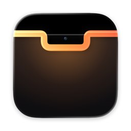
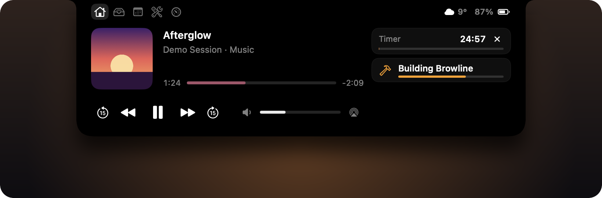

<p align="center">
  
</p>

<h1 align="center">Browline</h1>

<p align="center">
  MacBook'unuz için dinamik çentik: müzik, dosyalar, toplantılar, zamanlayıcılar ve yapay zekâ ajanlarınız,<br>
  kameranın hemen yanında.
</p>

<p align="center">
  <a href="https://github.com/tallat1/browline/releases/latest"></a>
  
  
  <a href="LICENSE"></a>
</p>

<p align="center"><a href="README.md">English</a> · <b>Türkçe</b></p>

<p align="center">
  <br>
  <sub>Görüntüde örnek veri kullanıldı.</sub>
</p>

> [!NOTE]
> Browline 0.9 herkese açık bir beta. Henüz Apple tarafından onaylanmadı (notarize edilmedi); macOS ilk açılışta
> onayınızı ister. Ayrıntı: [Kurulum](#kurulum).

## Özellikler

**Şimdi.** Olan her şey tek bakışta.
- Kapak rengine bürünen Now Playing denetimleri, sürüklenebilen ilerleme çubuğu, kaydırarak parça geçme; birden çok uygulama çalıyorsa seçici.
- Sıradaki toplantıya tek tıkla katılma. Mikrofonu sistem genelinde sessize alıp görüşmeye geri dönme.
- Kapalı çentikte canlı etkinlikler: müziğe tepki veren çubuklar, şarj, kullanımdaki kamera ve mikrofon, ekran kaydı, zamanlayıcılar, CI çalışmaları, Bluetooth pilleri ve ses çıkışı değişiklikleri.
- İsteğe bağlı olarak sistemin ses ve parlaklık göstergesinin yerine geçer.

**Raf.** Ekranın tepesinde bir bırakma alanı.
- Dosyaları çentiğe bırakın; AirDrop ile gönderin, paylaşın, sıkıştırın ya da Quick Look ile bakın.
- Görselleri JPEG, PNG, HEIC ya da daha küçük boyuta; videoları 1080p ya da 720p MP4'e veya yalnız sese dönüştürün. ffmpeg gerekmez.
- Ekran görüntüsünün köşede beliren küçük resmini doğrudan sürükleyin.
- Pano geçmişi: son 50 kopya, yalnız bellekte. Parola yöneticilerinin gizli işaretlediği öğeler hiç kaydedilmez.

**Takvim.** Bugünün etkinlikleri ve anımsatıcıları; anımsatıcıları çentikten tamamlayın.

**Araçlar.** Zamanlayıcı ve Pomodoro, hızlı not, ayna, tam bir terminal ve uyanık tutma.

**Durum.**
- Sistem: son on dakikanın işlemci, bellek ve ağ grafikleri; Bluetooth aygıtlarının pili.
- Claude Code'un kendi durum satırından plan kullanımı ve limit sıfırlanma zamanları (isteğe bağlı). Browline Claude oturumunuzu hiç okumaz.
- Seçtiğiniz depoların GitHub Actions çalışmaları, kendi `gh` aracınız üzerinden.

**Geliştiriciler ve yapay zekâ ajanları için.**
- `notch` komut satırı aracı, `browline://` URL şeması ya da Kestirmeler eylemleriyle kendi canlı etkinliklerinizi gösterin.
- Claude Code kancaları oturum başına "çalışıyor", "sizi bekliyor" ve "bitti" durumunu gösterir. Claude Code'un izin sorularını da çentikten yanıtlayabilirsiniz.
- Codex CLI örneği de var.

**Mac'inize uyar.**
- Ekran başına: çentik, çentiksiz ekranda menü çubuğunda hap, yüzen kart ya da kapalı.
- Tam ekranda, Mission Control'de ve oyunlarda gizlenir. Kilit ekranında kompakt bir şerit gösterir.
- Hareketi Azalt ve Düşük Güç Modu'na uyar. Boştayken işlemcinin yaklaşık %0,05'ini kullanır.
- Türkçe ve İngilizce.

## Gereksinimler

- macOS 14 Sonoma ya da sonrası.
- En iyisi çentikli bir MacBook. Çentiği olmayan ekranlarda hap ya da yüzen kart kullanılır.
- Evrensel uygulama (Apple silikon ve Intel). macOS 27'de Apple silikon üzerinde geliştirildi ve denendi; macOS 14, 15, 26 ve Intel kodda destekleniyor ama henüz denenmedi. [Geri bildirimlerinizi bekliyoruz](https://github.com/tallat1/browline/issues).

## Kurulum

1. [Son sürümden](https://github.com/tallat1/browline/releases/latest) `Browline-0.9.0.dmg` dosyasını indirin ve Browline'ı Uygulamalar klasörüne sürükleyin.
2. Browline'ı açın. Beta notarize edilmediği için macOS ilk açılışı engeller:
   - **macOS 15 ve sonrası:** Sistem Ayarları › Gizlilik ve Güvenlik'i açın, aşağıdaki "Browline engellendi…" satırında **Yine de Aç**'a tıklayın.
   - **macOS 14:** Uygulamalar'da Browline'a Control tuşuyla tıklayın, **Aç**'ı seçin, ardından yine **Aç**'a tıklayın.
3. Browline menü çubuğunda yaşar, Dock'ta simgesi yoktur. Kısa bir karşılama çentiği nasıl kullanmak istediğinizi sorar.

İzinler yalnız onları gerektiren bir özelliği açtığınızda istenir. Ayarlar › İzinler hepsini durumlarıyla listeler.

İndirmeyi doğrulamak için `shasum -a 256 Browline-0.9.0.dmg` çıktısını sürüm notlarındaki değerle karşılaştırın.

## Kullanım

- **Açma:** imleci çentiğe getirin, kısa bir gecikmeden sonra açılır (Ayarlar › Notch'tan ayarlanır); uzaklaşınca kapanır. Tıklarsanız ya da üzerinde aşağı kaydırırsanız açılır ve açık kalır. Esc, başka yere tıklama ya da yukarı kaydırma kapatır.
- **Bölümler:** Şimdi, Raf, Takvim, Araçlar ve Durum çentiğin üst şeridinde.
- **Ayarlar:** menü çubuğu simgesi › Ayarlar… (⌘,). Arama her seçeneği bulur.
- **Mikrofon:** ⌃⌥M hangi uygulamada olursanız olun mikrofonu sessize alır ya da açar. Kısayol Ayarlar'dan değiştirilir.

## Etkinlik API'si

Betikler, derleme araçları ve ajanlar çentikte kendi canlı etkinliklerini gösterebilir.

```sh
notch push  --id build --title "Derleniyor" --progress 40% --symbol hammer --tint "#FF9F0A"
notch end   --id build
notch flash --title "Derleme geçti" --symbol checkmark.circle.fill --tint "#34C759" --duration 3
```

Önce Ayarlar › Şimdi › Betik ve AI ajanı etkinlikleri'ni açın. Araç uygulamanın içinde: `/Applications/Browline.app/Contents/Helpers/notch`. Aynı işlemler URL olarak da çalışır; Raycast, Alfred ve Kestirmeler için uygundur. Bu bağlantıları web sayfaları da açabildiği için `browline://` bağlantılarının ayrı, varsayılanı kapalı bir anahtarı var:

```sh
open -g "browline://push?id=build&title=Derleniyor&progress=40%25&symbol=hammer"
```

Kestirmeler'e üç yerleşik eylem de gelir: etkinlik göster, etkinliği bitir ve kısa bildirim göster. Hepsi yalnız sizin kullanıcı hesabınızın açabildiği yerel bir Unix soketi üzerinden çalışır. Ayrıntılar ve sınırlar: [docs/DEVELOPMENT.md](docs/DEVELOPMENT.md#etkinlik-apisi).

### Claude Code ve Codex

[`Examples/`](Examples) klasöründe hazır kancalar var:

- **Claude Code durumu:** [`Examples/claude-code/settings-hooks.json`](Examples/claude-code/settings-hooks.json) içindeki `hooks` girdilerini `~/.claude/settings.json` ile birleştirin ve betik yolunu yazın.
- **İzin soruları:** aynı dosyadaki `PermissionRequest` girdisi çentiği araç, proje ve tam komutla açar; yalnız o istek için İzin ver ya da Reddet sunar.
  - Karar yalnız sizin tıklamanızla verilir.
  - Kalıcı kural hiç yazılmaz.
  - Yanıt vermezseniz Claude Code kendi sorusuyla devam eder.
- **Codex CLI:** `~/.codex/config.toml` içinde `notify = ["/bin/bash", "/yol/Examples/codex/notch-notify.sh"]`.

## Gizlilik

- **Hesap, analiz ya da telemetri yok.** Browline hiçbir yere rapor göndermez.
- **Verileriniz yerelde kalır.** Ayarlar, raf listesi ve notlar `~/Library/Application Support/com.talatozcoban.browline` içinde durur. Pano geçmişi yalnız bellektedir, uygulama kapanınca silinir.
- **Claude limitleri** (isteğe bağlı) Mac'inizdeki Claude Code dosyalarını okur: hesap adı, durum satırının kullanım değerleri ve oturum kayıtlarındaki limit bildirimleri. Hiçbir şey Mac'inizden çıkmaz.
- **Ağ erişimi yalnız açtığınız özellikler için:**

| Özellik | Bağlandığı yer | Gönderilen |
|---|---|---|
| Hava durumu | [Open-Meteo](https://open-meteo.com) | Seçtiğiniz şehrin koordinatları; konumunuz değil |
| CI durumu | GitHub, kendi `gh` aracınız üzerinden | Browline'ın kendisi hiçbir şey göndermez; `gh` kendi oturumunu kullanır |

**İzinler.** Her biri yalnız ilgili özellik açıksa istenir:

| İzin | Ne için |
|---|---|
| Takvimler, Anımsatıcılar | Bugünün etkinlikleri ve anımsatıcıları |
| Kamera | Ayna, yalnız açıkken |
| Sistem sesi kaydı | Müziğe tepki veren çubuklar. Hiçbir şey kaydedilmez ya da saklanmaz. |
| Otomasyon | Sistem medya hizmeti kullanılamadığında Music ve Spotify'ı denetlemek |
| Erişilebilirlik | Sistemin ses ve parlaklık göstergesinin yerine geçmek (isteğe bağlı) |
| Diğer uygulamalardan yapıştırma | Pano geçmişi (isteğe bağlı) |

## Belgelenmemiş API'ler

macOS'un herkese açık API sunmadığı yerlerde Browline özel API'ler kullanır. Her biri çalışma anında aranır; sembol yoksa özellik kendini kapatır. Bir macOS güncellemesi bu özellikleri bozabilir ve Browline'ın Mac App Store'da yer alamamasının nedeni de bunlardır.

| Özellik | API |
|---|---|
| macOS 15.4 ve sonrasında Now Playing | MediaRemote, [mediaremote-adapter](https://github.com/ungive/mediaremote-adapter) üzerinden |
| Parlaklık göstergesi | DisplayServices |
| Ekran kaydı göstergesi | SkyLight `CGSIsScreenWatcherPresent` |
| Kilit ekranı paneli (deneysel, varsayılan kapalı) | SkyLight alanları |

## Kaynaktan derleme

Xcode 26 ya da sonrası, [XcodeGen](https://github.com/yonaskolb/XcodeGen) ve CMake gerekir:

```sh
brew install xcodegen cmake
git clone https://github.com/tallat1/browline.git
cd browline
make run                                          # yardımcıları derler, projeyi üretir, derler ve açar
make run XCODE_FLAGS='DEVELOPMENT_TEAM=ABCDE12345' # kendi takımınızla imzalar
make test                                         # birim testleri
```

Sabit bir imza kimliği macOS izinlerini yeniden derlemelerde korur. Ad-hoc imza (`XCODE_FLAGS='CODE_SIGN_IDENTITY=- DEVELOPMENT_TEAM='`) çalışır ama macOS her derlemeden sonra izinleri yeniden sorar. `Scripts/release.sh` evrensel, hardened runtime'lı DMG'yi üretir.

| Yol | İçinde |
|---|---|
| `App/` | Özellik bazlı düzenlenmiş uygulama: `Core` (koordinatör, gezinme, ayarlar), `Notch` (kapalı ve açık notch), `Features/<özellik>`, `DesignSystem`, `Settings`, `Application`; ayrıntı [ARCHITECTURE.md](docs/ARCHITECTURE.md) |
| `Packages/NotchCore/` | Swift paketi: panel ve geometri (`NotchShell`), etkinlik önceliği (`ActivityEngine`), sistem entegrasyonları (`Integrations`), soket protokolü (`ActivityAPI`), özel API köprüleri (`PrivateBridges`) |
| `CLI/` | `notch` komut satırı aracı |
| `Helpers/`, `ThirdParty/` | Now Playing yardımcıları |
| `Examples/` | Claude Code ve Codex kancaları |
| `docs/ARCHITECTURE.md` | Modüller, veri akışı, kurallar ve yeni özellik ekleme (İngilizce) |
| `docs/DEVELOPMENT.md` | Mühendislik notları, ölçümler ve tasarım kararları |

## Yol haritası

- 1.0 için Developer ID imzası ve notarization
- Otomatik güncelleme
- macOS 14, 15, 26 ve Intel Mac'lerde deneme
- Odak (Focus) modu

## Katkı

Hata bildirimleri, fikirler ve pull request'ler memnuniyetle karşılanır; büyük değişiklikler için önce bir [issue](https://github.com/tallat1/browline/issues) açın. Browline temiz oda (clean-room) yöntemiyle yazıldı: başka çentik uygulamalarından (birçoğu GPL lisanslı) kod kopyalamayın.

## Teşekkürler

- [mediaremote-adapter](https://github.com/ungive/mediaremote-adapter), Jonas van den Berg (BSD 3-Clause)
- [SwiftTerm](https://github.com/migueldeicaza/SwiftTerm), Miguel de Icaza (MIT)
- Çentik uygulamaları topluluğundan fikirler: NotchNook, Alcove, boring.notch, Atoll, DynamicLake, MediaMate ve diğerleri. Browline onların kodunu içermez.

Lisans metinlerinin tamamı: [THIRD_PARTY_NOTICES.md](THIRD_PARTY_NOTICES.md).

## Lisans

[MIT](LICENSE) © 2026 Talat Özçoban
