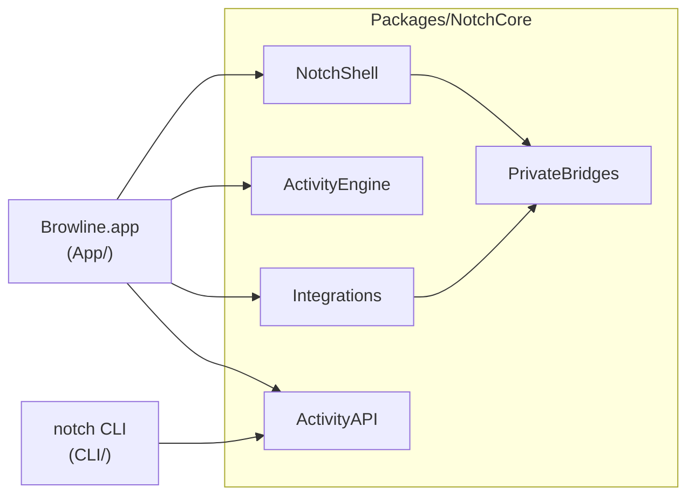
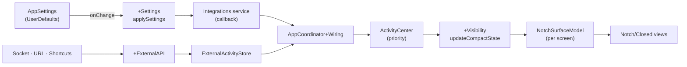

# Architecture

Browline is a menu bar agent app (no Dock icon) that draws a panel over the MacBook notch on every screen. This document explains how the code is organized, how data flows through it, and where new code belongs. Engineering notes and measurements live in [DEVELOPMENT.md](DEVELOPMENT.md) (Turkish).

## Targets and modules



| Module | Responsibility | May import |
|---|---|---|
| `NotchShell` | Panels (`NSPanel` per screen), notch geometry and shape, hover / peek / open states, file drag detection, lock screen presenter | AppKit, SwiftUI, `PrivateBridges` |
| `ActivityEngine` | `ActivityCenter`: which activity the closed notch shows, by priority; live activities and timed flashes | Foundation |
| `Integrations` | One service per system feature: Now Playing, battery, calendar, shelf, Bluetooth, microphone, CI, system stats, … | AppKit, system frameworks, `PrivateBridges` — **no SwiftUI** |
| `ActivityAPI` | Activity protocol, validation, Unix socket server and client, URL scheme, questions, CLI and API messages | Foundation |
| `PrivateBridges` | The only place with undocumented APIs, resolved at runtime with `dlsym`; a missing symbol turns the feature off | Foundation |

Rules:
- Dependencies point one way: the app depends on the package, never the reverse.
- Services in `Integrations` expose state and callbacks; they never present UI or know about other services. Combining them is the app's job.
- Anything undocumented goes through `PrivateBridges` (or the media helpers in `Helpers/` and `ThirdParty/`).

## The app

```
App/
├─ Application/   main.swift, AppDelegate (+StatusMenu), logging, quarantine cleanup for bundled helpers
├─ Core/          AppCoordinator (+ purpose extensions), Navigation (sections, pages, UI state), AppSettings (+Migration)
├─ Notch/
│  ├─ Closed/     NotchRootView, compact leading/trailing wings, lock screen views
│  ├─ Expanded/   ExpandedView, section bar, page picker, detail header, status area, page sizes
│  └─ Question/   Allow / Deny question view
├─ Features/      One folder per feature: its notch pages, cards and presentation extensions
│                 (Now, Media, Shelf, Calendar, Tools, Status, Indicators, Meetings)
├─ DesignSystem/  NotchDesign tokens, button styles, marquee text, indicators, formatters
├─ Settings/      Window/ (window, sidebar, search, form components, option titles) · Pages/ · Permissions/ · Onboarding/
├─ Shortcuts/     App Intents (Shortcuts actions)
└─ Debug/         Debug command channel and demo mode (compiled only in Debug builds)
```

### AppCoordinator

`AppCoordinator` is the composition root. It owns every service, the UI state and the panels; its behavior is split by purpose:

| File | Purpose |
|---|---|
| `AppCoordinator.swift` | Services, UI state, delegate callbacks, shared state, `init`, `start()`, `stop()` |
| `+Wiring` | Connects service callbacks to the activity center and UI state, one `wire…()` function per area. Only assigns callbacks; it never starts a service |
| `+Settings` | `applySettings()`: starts, stops and reconfigures services whenever a setting changes. Idempotent |
| `+Navigation` | Available sections and pages, selection, opening the notch or settings at a page |
| `+Visibility` | User hiding, lock screen behavior, pushing the current activity to each panel's compact state |
| `+ExternalAPI` | Socket server, URL scheme, Shortcuts and questions |
| `+Actions` | Feature actions: microphone, Bluetooth notices, timer and Pomodoro, shelf drops, media swipes |
| `+ActivityKind` | Activity identifiers, which ones need a wide wing or may appear on the lock screen, notice durations |

## Data flow



- **Closed notch.** A service reports a change through its callback. `+Wiring` turns it into a live activity (`setLive` with a priority) or a short notice (`flash`). `ActivityCenter` picks the winner; `+Visibility` hands its identifier to every panel's `NotchSurfaceModel`, and the closed views draw it.
- **Open notch.** `ExpandedView` shows the selected `NotchPage`. Pages belong to sections (`NotchSection`); a page is available when its feature is on and the user hasn't hidden it.
- **Settings.** `AppSettings` is `@Observable` and persists to `UserDefaults`. Every change calls `applySettings()`, which brings each service to the right state, so the order of changes never matters.
- **External activities.** Socket, URL and Shortcuts requests go through the same validation in `ActivityAPI` and the same `activityAPIEnabled` switch. Questions (Claude Code permission prompts) open the notch, and only a click answers them.

## Conventions

- One primary type per file. Large types are split into `Type+Purpose.swift` extensions; members shared across those files are internal and grouped under a "shared state" mark.
- Presentation code for a service type (titles, symbols, colors) lives in the app as `Type+Presentation.swift`, inside the folder of the feature that shows it, never in the package.
- Notch pages are named `…Page` (`MediaPage`, `ShelfPage`); settings pages `…SettingsPage`. `NotchPage` lists the pages, `NotchSection` the top bar sections.
- Identifiers are English. Comments and the source language of UI strings are Turkish; English comes from `App/Localizable.xcstrings`.
- Storage keys and debug command names never change once shipped, even when the code is renamed (for example, the hidden pages setting still uses the `"hiddenTabs"` key).
- Debug-only code lives in `App/Debug` behind `#if DEBUG` and must not leak into Release builds. `Scripts/release.sh` builds Release: shipped code that calls a debug-only symbol fails to compile there.

## Adding a feature

1. **Service.** Add `Packages/NotchCore/Sources/Integrations/<Feature>/` with a type that publishes state and callbacks, plus tests in `Packages/NotchCore/Tests/NotchCoreTests/<Feature>Tests.swift`.
2. **Coordinator.**
   - Own the service in `AppCoordinator.swift`.
   - Connect its callbacks in a `wire…()` function in `+Wiring`.
   - Start and stop it in `applySettings()` in `+Settings`.
   - If it shows in the closed notch, add an identifier and priority in `+ActivityKind`.
3. **Setting.** Add the property and its default to `AppSettings`. If you change an existing default, add a migration in `AppSettings+Migration` so current users keep what they see.
4. **UI.**
   - Add `App/Features/<Feature>/<Feature>Page.swift`.
   - In `Core/Navigation.swift`, add a `NotchPage` case with its symbol, title and section, and list it in `NotchSection.pages`.
   - Give it a height in `Notch/Expanded/NotchPage+Layout.swift` and make it reachable through `isModuleEnabled(for:)` in `+Navigation`.
   - Add the page to the switch in `ExpandedView`.
5. **Settings UI.** Add a toggle on the right `…SettingsPage` and an entry in `Settings/Window/SettingsSearch.swift`.
6. **Strings.** Build, then run `xcrun xcstringstool sync` (see DEVELOPMENT.md) and add English translations.
7. **Verify.** Run `make test`, `make run`, and `Scripts/release.sh --dry-run` before committing.
