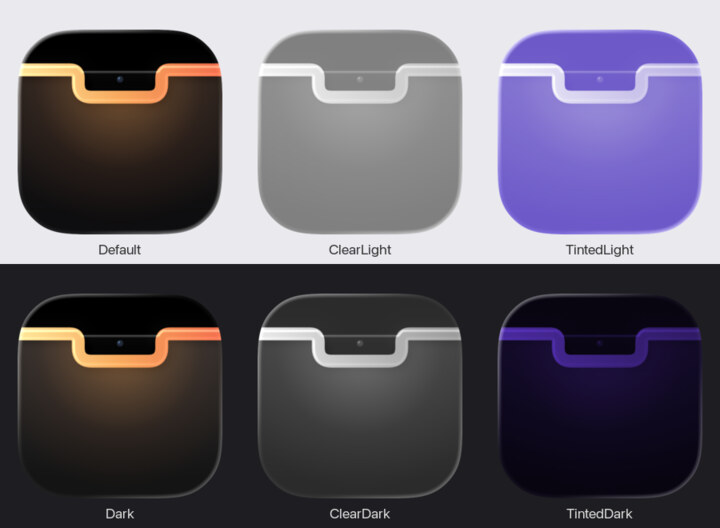

# Browline — geliştirme notları

Kullanıcı belgesi kökteki [README](../README.md) ([Türkçe](../README.tr.md)). Bu dosya mühendislik kayıtları:
Faz 0 prototipinin (ayrı, yayımlanmamış bir depo) ölçülmüş kararları, tasarım turları, ölçümler ve tuzaklar. Notlar tarih
sırasıyla eklendi; bir bölüm sonradan değiştiyse o bölümde yazar.

Eski çalışma adı NotchMVP, eski paket kimliği `com.talatozcoban.notchmvp`. 0.9.0'dan itibaren kimlik
`com.talatozcoban.browline`; ilk açılışta `LegacyMigration` eski ayarları ve veri klasörünü taşır, TCC izinleri
kimliğe bağlı olduğu için bir kez yeniden verilir. `notchmvp://` şeması eski betikler için çalışmaya devam eder.

## Derleme ve çalıştırma

Gereken araçlar: Xcode 26.5+, `xcodegen`, `cmake` (Homebrew).

```sh
make run        # adaptörü derler, projeyi üretir, debug derler ve açar
make test       # NotchCore birim testleri (swift test)
make measure    # kapalı notch boşta CPU / uyanma ölçümü (60 sn)
make stop
swift Scripts/smoke-test.swift   # debug: durumları gezer, yalnız panel penceresinin görüntüsünü alır
```

Yeni Swift dosyası eklenince proje yeniden üretilmeli; `make build` bunu yapar (`xcodegen generate`).
SwiftTerm paketinde derleme eklentisi var: komut satırında `xcodebuild -skipPackagePluginValidation` (Makefile
veriyor); Xcode'da açınca eklentiye bir kez onay istenir.
İmza "Apple Development" kimliğiyle: ad-hoc imza her derlemede değişir ve Takvim/Automation izinleri sıfırlanır.

## Yapı

Modüller, veri akışı ve yeni özellik ekleme: [ARCHITECTURE.md](ARCHITECTURE.md) (İngilizce, 2026-10-16 mimari düzenlemesi).

| Yer | İş |
|---|---|
| `Packages/NotchCore/Sources/NotchShell` | Panel (`NSPanel`, `.mainMenu + 3`), geometri, `NotchShape`, hover/peek/açık durumları, ekran başına yönetici, tam ekran sezgisi, sürükleme algılama |
| `Packages/NotchCore/Sources/ActivityEngine` | Kompakt notch'ta hangi etkinliğin görüneceği: canlı etkinlikler önceliğe göre, geçici olanlar süre boyunca önde |
| `Packages/NotchCore/Sources/Integrations` | Now Playing (adaptör + Music/Spotify yedeği), pil (IOKit), takvim (EventKit), dosya rafı (bookmark), kamera/mikrofon göstergesi (CMIO/CoreAudio), ses/parlaklık HUD'ı (CoreAudio + medya tuşu tap'i), indirmeler |
| `Packages/NotchCore/Sources/PrivateBridges` | Private API'nin tek yeri, `dlsym` ile; sembol yoksa özellik kapanır: DisplayServices parlaklığı, SkyLight kilit ekranı Space'i |
| `Packages/NotchCore/Sources/ActivityAPI` | Dış etkinlik API'si: JSON satır protokolü, doğrulama, Unix soketi sunucusu/istemcisi, durum |
| `CLI/` | `notch` komut satırı aracı; uygulama paketinde `Contents/Helpers/notch` |
| `App/Core` | `AppCoordinator` (bileşim kökü; amaç bazlı uzantılar: `+Wiring`, `+Settings`, `+Navigation`, `+Visibility`, `+ExternalAPI`, `+Actions`, `+ActivityKind`), gezinme (`NotchSection`, `NotchPage`), `AppSettings` |
| `App/Notch` | `Closed/` kapalı ve kompakt notch, kilit ekranı · `Expanded/` açık notch çerçevesi · `Question/` onay sorusu |
| `App/Features/<özellik>` | Notch sayfaları (`…Page`), kartlar ve servis türlerinin arayüz uzantıları (`Tür+Presentation`) |
| `App/DesignSystem`, `App/Settings`, `App/Application`, `App/Shortcuts`, `App/Debug` | Ortak görsel dil · ayar penceresi ve sayfaları (`…SettingsPage`) · giriş ve menü çubuğu · Kestirmeler · yalnız Debug |
| `ThirdParty/mediaremote-adapter` | ungive/mediaremote-adapter `e3ff502`, BSD-3, değiştirilmedi |
| `Helpers/MediaSessions` | Çoklu medya oturumu yardımcısı (kendi kodumuz, Objective-C + perl yükleyici); `make sessions` |

## Faz 0'dan gelen kararlar

- Pencere seviyesi `.mainMenu + 3`: tam ekranda `.screenSaver` ile fark ölçülmedi; `.screenSaver` açılır menüleri,
  Control Center'ı ve parola diyaloğunu örtüyor.
- Tıklama geçirgenliği şeffaf piksel yöntemiyle (`ignoresMouseEvents` hiç atanmaz): en az uyanma.
- Açıkken global imleç izleyicisi kurulur ve hover çıkışı ayrıca denetlenir (Faz 0'da bir kez 106 sn açık kalma görüldü).
  İzleyici notch kapanınca kaldırılır.
- Panelden pencere açılmaz: uygulamayı etkinleştirmek kullanıcıyı tam ekran Space'inden atıyor. Ayarlar menü çubuğundan.
- Geometri her ekran değişiminde `safeAreaInsets` ve yardımcı alanlardan yeniden okunur (çentik 24,5–38 pt arası değişiyor).
- Kapalı notch'ta sürekli animasyon ya da zamanlayıcı yok; ilerleme çubuğu yalnız açık ve çalarken saniyede bir çizilir.

## Medya sekmesi

- Kapağa tıklayınca çalan uygulama öne gelir.
- İlerleme çubuğu tıklanır ya da sürüklenir (18 pt tutma alanı; üzerine gelince kalınlaşır, tutamaç çıkar,
  süreler sürüklenen konumu gösterir); bırakınca `seek`, çubuk akışı beklemeden yeni konuma atlar.
- ±15 sn: oynatıcının kendi 15 sn komutu değil `seek` (Spotify o desteği bildirmiyor). Yedek kaynakta
  (AppleScript) konum bilinmediği için gizli.
- ⚠️ Spotify MediaRemote konum komutunu doğru işlemiyor (2026-10-16: 2 sn geri istendi, sonraki şarkıya geçti).
  Spotify ve Music'te konum AppleScript ile değişir (`set player position`, ayrı `osascript` süreci); ilk
  kullanımda macOS "Browline, Spotify'ı denetlemek istiyor" diye sorar. Diğer oynatıcılarda MediaRemote.
- Karıştır ve tekrar yalnız oynatıcı durumunu bildiriyorsa görünür (Music bildirir, Spotify bildirmez).
- Ses kaydırıcısı, sessize alma ve çıkış cihazı menüsü (`VolumeController`, CoreAudio, izinsiz); dinleyiciler
  yalnız sekme açıkken. Kaydırıcı, ilerleme ya da menü kullanılınca notch sabitlenir, imleç kayınca kapanmaz.
- Açık notch'ta yatay iki parmak kaydırma parça geçirir.
- Adaptör komutlarının başarısızlığı artık günlüğe düşer ("Medya komutu başarısız").
- Konum eşitleme: medya sekmesi görünürken ve Spotify/Music çalarken 3 sn'de bir gerçek konum AppleScript'le
  sorulur; fark 0,75 sn'yi geçerse çubuk düzeltilir ve günlüğe "konum kayması … düzeltildi" yazılır. Düzeltme,
  kaynak yeni konum bildirene kadar geçerli (`PositionCorrection`). Ölçüm (2026-10-16): sabit durumda fark −0,2 sn.
  Debug `media:drift` tek ölçüm yazar.
- Birden çok oynatıcı (ör. Chrome'da video, Spotify'da şarkı): sağ üstte uygulama simgeleriyle oturum seçici,
  çalanın simgesinde nokta. Seçilen oturum gösterilir ve denetimler ona gider; sekme kapanınca seçilen
  çalmıyorsa bırakılır. Oynatıcı sonraki/önceki desteklemiyorsa (Chrome'da tek video) düğmeler soluk.

## Hareket standardı (ürün geneli)

Tek kaynak `NotchShell/NotchMotion.swift`; görünümlerde süre ya da eğri elle yazılmaz.

| Durum | Ne kullanılır | Not |
|---|---|---|
| Notch açılış / kapanış | `NotchMotion.open` / `.close` (kritik sönümlü yay 0,40 / 0,45 sn) | Kabukta |
| Kanat genişliği, sekme boyu | `NotchMotion.resize` (yay 0,38 sn, çok hafif esnek) | Eskiden kanat genişliği canlı değildi |
| İçerik değişimi (sekme, durum, şarkı, etkinlik) | `.notchTransition(.swap)` + `.notchAnimation(value:)` | `.id(durum)` ile kimlik değişir, çapraz geçiş |
| Liste öğesi ekleme/çıkarma | `.notchTransition(.listItem)` | Etkinlikler, raf, takvim, anımsatıcılar |
| Küçük öğe (durum çipi, kapak) | `.notchTransition(.fade)` | |
| Sayılar | `.contentTransition(.numericText())` | Geri sayım `countsDown`, yüzdeler, pil |
| Düzey çubukları, halka | `LevelBar`, `ProgressRing` kendi içinde canlı | |
| Üzerine gelme | `NotchMotion.hover` (0,12 sn) | Düğme zemini, kalınlaşan çubuk |
| Panel görünür/gizli | `NotchPanel.fadeIn/fadeOut` (0,2 sn saydamlık) | Boştaki yüzey önce kapanmasını bitirir (0,35 sn) |
| Uzun metin | `MarqueeText`: kanatta bir kez, açık başlıkta döngü, listede üzerine gelince | Bildirim süresi `readableFlashDuration` ile uzar |
| Ayarlar penceresi | `.notchAnimation(value: …Reveal)` | Açılan satırlar birden belirmez |

Hareketi azalt açıkken `.notchTransition` yalnız saydamlığa, `.notchAnimation` kısa saydamlık geçişine iner;
kayan yazı kaymaz. Kökten düzeltilenler: sekme yalnız şerit düğmesinden değişince canlıydı (dosya sürükleme,
ayar ve debug yolu sıçrıyordu); panel `orderOut/orderFront` ile anında kaybolup beliriyordu; şarkı geçişinde
oynatıcının anlık "çalan yok" bildirimi notch'u kapatıp açıyordu.

## Kapalı notch'ta ekolayzer

Müzik çalarken sağ kanattaki dört çubuk hafifçe oynar (ses verisi değil; her çubuk farklı süreyle salınır).
Kapalı notch'taki tek sürekli animasyon olduğu için ölçülerek seçildi (2026-10-16, müzik çalarken 20 sn):

| Yöntem | CPU | Güç |
|---|---|---|
| Durağan dalga (önceki) | %0,32 | 0,63 mW |
| SwiftUI `TimelineView(.animation)` 12 kare + ara yumuşatma | %7,3 | 15,7 mW |
| SwiftUI `TimelineView` 12 kare, yumuşatmasız / `.periodic` | %5,8–12 | 11–168 mW |
| **Core Animation katmanı (`EqualizerBars`)** | **%0,33** | **0,71 mW** |

SwiftUI her karede büyük saydam paneli yeniden çizdiriyor; Core Animation animasyonu pencere sunucusunda
yürür, uygulama uyanmaz. Duraklatınca, azaltılmış harekette ya da Ayarlar › Notch › Hareket'ten kapatılınca durur.

**Müziğe tepki (isteğe bağlı, varsayılan kapalı).** Ayarlar › Notch › Hareket › "Çubuklar müziğe tepki versin".
`AudioSpectrum` sistem sesinin kopyasını Core Audio süreç dinleyicisinden alır (`CATapDescription`, macOS
14.2+, özel küme aygıtı), 1024 örnekte bir FFT ile dört banda böler (40–160 / 160–640 / 640–2500 /
2500–10000 Hz). Her bant kendi yakın geçmiş tepesine göre 15 dB aralıkta ölçeklenir (ses düzeyinden
bağımsız), 1,4 eğriyle vuruş belirginleşir; hızlı yükselir, yavaş iner. Çubuklar ekran bağlantısıyla 30 Hz.

- İzin: ilk açılışta macOS sistem sesi kaydı izni ister (`NSAudioCaptureUsageDescription`). İmza geliştirici
  sertifikasıyla olduğu için izin yeniden derlemede korunur. Ses kaydedilmez, yalnız dört sayı çıkar.
- Sinyal 1,2 sn yoksa (izin verilmedi, sessiz geçiş) çubuklar yapay harekete döner; hiç donmaz.
- Dinleyici yalnız çubuk görünür ve çalarken açık. Kısa bildirim çubukların yerini alınca 5 sn bekler,
  sonra küme aygıtı ve dinleyici silinir. Çıkış aygıtı değişince yeniden kurulur.
- Ölçüm (2026-10-16, Debug, müzik çalarken, `top` 2 sn aralık): tepkili kip, çubuklar görünürken uygulama
  toplamı %0,9–1,4. Analiz kuyruğu tek çekirdeğin %0,6'sı (`sample` 3 sn). İlk sürümde örnek başına
  Swift döngüleri %7 tutuyordu; karıştırma ve bant toplamları vDSP'ye taşındı.
- 30 dB aralıkta çubuklar hep tepede kalıyordu (6 dB'lik vuruşta salınım 0,15). Test
  `sixDecibelBeatsSwingTheBar` 0,4 altını kırmızı sayar.

## Hareket ve şarkı geçişleri

- Tek hareket sistemi `NotchShell/NotchMotion.swift`: açılış/kapanış kritik sönümlü yay, kanat genişliği ve
  sekme boyu hafif esnek yay, içerik değişimi 0,28 sn çapraz geçiş; hepsi aynı yay ailesi, üst üste binince hız
  korunarak birleşir. Kanat genişliği eskiden canlandırılmıyordu (şarkı önizlemesinde şekil sıçrıyordu).
- Şarkı geçişi: oynatıcı bir an "çalan yok" ya da "duraklatıldı" bildiriyor. Bilgi 1,5 sn, kanat 1,2 sn
  bekletilir; yeni bilgi gelirse arayüz hiç boşalmaz. Yeni kapak başlıktan sonra geldiği için eski kapak en çok
  2 sn korunur (yer tutucu titremez); kapak, başlık ve kanat içeriği çapraz geçişle değişir.
- Uzun ad (`MarqueeText`): sığmıyorsa 0,9 sn bekler, 30 pt/sn sabit hızla kayar, sonda 1,2 sn durur, yumuşakça
  başa döner; kenarlarda soluklaşma, alan dışına taşma yok. Kısa adda hareket yok; Hareketi azalt açıksa kaymaz.
  Şarkı önizlemesinin süresi adın bir tur kayma süresine göre uzar; açık medya sekmesinde döngü, kapalı
  notch'taki dış etkinlikte tek tur (sürekli animasyon yok).

## Now Playing katmanları

1. Açılışta `mediaremote-adapter test` (≈0,2 sn). Geçerse `stream --micros` ile sistem geneli kaynak.
2. Geçmezse ya da akış sıfır dışı kodla kapanırsa: Music ve Spotify dağıtık bildirimleri (okuma izinsiz),
   komutlar AppleScript ile (Automation izni). Kapak ve konum yok.
3. Arayüz ve menü hangi kaynağın kullanıldığını gösterir.
4. Adaptör yalnız sistemin seçtiği oynatıcıyı verir; iki medya açıkken diğeri görünmüyordu. Çoklu oturum
   yardımcısı (`Helpers/MediaSessions`, adaptör gibi `/usr/bin/perl` yükler) tüm oynatıcıları ayrı okur:
   `MRMediaRemoteGetNowPlayingClients` + oynatıcı yolu başına bilgi, durum ve etkin komutlar; bildirimle,
   en geç 5 sn'de bir; yalnız değişince bir JSON satırı, kapak yalnız değişince. ⚠️ Belgelenmemiş işlevler;
   imzalar macOS 27'de disassembly ve denemeyle doğrulandı. Yardımcı yoksa ya da çökerse tek oturuma düşülür.
   - Odak: elle seçilen → çalanlardan sistemin seçtiği → en son çalmaya başlayan → sistemin seçtiği. Sistem
     duraklatılmış bir videoyu seçmişken çalan şarkı artık gizlenmez.
   - Komutlar: sistemin seçtiği oturuma adaptörle (eski yol); diğerine Spotify/Music ise AppleScript (Spotify
     doğrudan yolda sonraki/önceki komutunu reddediyor), başka oynatıcıysa `MRMediaRemoteSendCommandToPlayer`.
   - ⚠️ İki uzun ömürlü süreç çıktısı `FileHandle.bytes` ile okunmaz: okumalar ortak yürütücüde sıraya giriyor,
     veri beklemeyen akış diğerini durduruyor (yardımcı dolu boruda `write`'ta kaldı). `PipeLineReader`
     (`readabilityHandler`) kullanılır.

## Etkinlik API'si

Betikler, AI ajanları ve Kestirmeler (Kabuk Betiği Çalıştır) notch'a etkinlik gönderebilir. Kanal yerel Unix soketi:
`~/Library/Application Support/com.talatozcoban.browline/activity.sock` (dosya 0600, klasör 0700, bağlanan sürecin
kullanıcı kimliği ayrıca denetlenir). Satır başına bir JSON istek, satır başına bir JSON yanıt.

```sh
notch push  --id build --title "Derleme" --subtitle "Browline" --progress 40% --symbol hammer --tint "#FF9F0A"
notch end   --id build
notch flash --title "Derleme bitti" --symbol checkmark.circle.fill --tint "#34C759" --duration 3
notch list
```

- Sınırlar: en çok 8 etkinlik; id `[A-Za-z0-9._-]{1,64}`; başlık 80, alt başlık 120 karakter; öncelik 0–50
  (yerleşikler: Now Playing 30, toplantı 40); güncellenmeyen etkinlik `--ttl` (varsayılan 600 sn) sonunda düşer.
- Çıkış kodları: 0 tamam, 1 uygulama hatası (doğrulama), 2 kullanım, 3 uygulama çalışmıyor.
- Dil: `notch` aracının kullanım/hata çıktıları ve API yanıt metinleri dil sırasının ilkine göre Türkçe ya da
  İngilizce (`APILanguage`; ilk dil `en-TR` ise İngilizce, uygulamanın kendisi gibi). Doğrulama hataları alan ve
  dilden bağımsız kural taşır (`invalid("title", rule: "≤ 80")`); testler metne değil türe bakar.
- Dış etkinlik öne çıkınca kompakt kanatlar genişler (128 pt): solda sembol ve başlık, sağda ilerleme ya da alt başlık.
- Ham protokol: `echo '{"op":"ping"}' | nc -U "$HOME/Library/Application Support/com.talatozcoban.browline/activity.sock"`

Aynı etkinlik iki kapıdan daha gelir; ikisi de soketi dolaşmadan aynı işleyiciye girer, aynı sınırlar ve aynı
"Etkinlik API'si" ayarı geçerlidir:

- **URL şeması** (Raycast, Alfred, Kestirmeler "URL'yi Aç", betikler). Şema `browline://` (eski `notchmvp://` da çalışır). Yalnız `push`, `end`, `flash`; parametreler
  `notch` aracıyla aynı, `%` URL'de `%25` yazılır. Betikten çağırırken `open -g` kullanın: `-g` olmadan macOS
  uygulamayı öne alır (uygulama odağı önceki uygulamaya geri verir, ama bir an kayar).

  ```sh
  open -g "browline://push?id=build&title=Derleme&progress=40%25&symbol=hammer&tint=%23FF9F0A"
  open -g "browline://end?id=build"
  open -g "browline://flash?title=Bitti&symbol=checkmark.circle.fill&duration=3"
  ```

  ⚠️ Bir web sayfası da bu bağlantıyı açabilir (tarayıcı önce sorar); en kötü durumda notch'ta yabancı bir metin
  görünür. Kilit ekranında dış etkinlikler zaten gösterilmez.
- **Kestirmeler eylemleri** (App Intents): "Notch'ta etkinlik göster", "Notch etkinliğini bitir", "Notch'ta kısa
  bildirim göster". Uygulamayı öne almaz; hata mesajı Kestirmeler'de görünür.

### AI ajanları

`Examples/` altında hazır örnekler; ikisi de bağımlılıksız (JSON `plutil` ile okunur) ve ajanı hiçbir koşulda
engellemez. `notch` aracının yolu `NOTCH_CLI` ile verilir (varsayılan `/Applications/Browline.app/Contents/Helpers/notch`).

- **Claude Code** (`Examples/claude-code/notch-hook.sh`): istem gönderilince ve her araçtan sonra "Claude
  çalışıyor" (proje adıyla), izin istenince turuncu "Claude onay bekliyor", yanıt bitince "Claude bitti". Oturum
  başına ayrı etkinlik (`claude.<oturum>`). Kurulum: `Examples/claude-code/settings-hooks.json` içindeki
  `NOTCH_HOOK_PATH`'i betiğin yoluyla değiştirip `~/.claude/settings.json` içindeki `hooks` ile birleştirin.
- **Claude Code izin istemleri notch'tan** (`notch claude-permission`, `PermissionRequest` kancası): Claude izin
  sormak üzereyken notch açılır; araç, proje ve tam komut görünür, "Reddet" / "İzin ver" (yalnız bu istek) ya da
  "Claude'da yanıtla". Kurulum: `settings-hooks.json` içindeki `PermissionRequest` girdisi (`NOTCH_CLI_PATH` =
  `notch` aracının yolu). Kurallar:
  - Karar yalnız kullanıcının tıklamasıyla; kalıcı izin kuralı (`updatedPermissions`) hiç yazılmaz.
  - Yanıt yoksa (süre dolar, "Claude'da yanıtla", uygulama kapalı, hata) kanca hiçbir şey yazmaz ve 0 ile çıkar:
    Claude kendi izin penceresiyle devam eder. Soru 110 sn'de düşer, kanca zaman aşımı 120 sn.
  - Masaüstü uygulamasında kanca uygulamanın kendi onay penceresiyle yarışır, önce karar veren geçerli (belge).
    Orada yanıtlanırsa kanca süreci kapanır, soket bağlantısı kopar, soru notch'tan düşer.
  - Notch soru gelince kendiliğinden açılır; karar düğmeleri ilk 0,8 sn pasif (yanlışlıkla tıklama).
  - Genel API: `notch ask --id ID --title … [--detail …] [--timeout SN]` yanıtı yazar (`allow` | `deny`), yanıt
    yoksa çıkış 4. Ayarlar › Şimdi › "Claude Code izin istemlerini notch'ta yanıtla" kapalıysa hemen yanıtsız döner.
  - ⚠️ Terminal CLI'de Claude'un kendi penceresinin kanca beklerken görünüp görünmediği belgelenmemiş; denenmedi.
- **Codex CLI** (`Examples/codex/notch-notify.sh`): tur bitince "Codex bitti". `~/.codex/config.toml`:
  `notify = ["/bin/bash", "/YOL/notch-notify.sh"]`. Codex bildirim alanları sürüme göre değişebilir; betik yalnız
  tür ve klasörü okur.

## Durum (2026-10-16)

| MVP maddesi | Durum |
|---|---|
| Ekran başına panel, idempotent yeniden kurulum, ekran politikası, hap yedeği | ✓ yazıldı; yerleşik ekranda görsel doğrulandı |
| Kapalı / peek / kompakt / açık durumlar, hover gecikmesi, tıklayınca sabitleme, kaydırma, Reduce Motion | ✓ yazıldı; kapalı, kompakt ve açık durumlar görsel doğrulandı |
| Now Playing (adaptör + yedek), kapak rengi | ✓ adaptör macOS 27.0.1'de geçti, Spotify verisi göründü; yedek yol denenmedi |
| Pil, takvim (toplantıya katıl), raf + AirDrop, sürükleyince açılma | ✓ yazıldı; pil görsel doğrulandı; takvim izni verilip, dosya sürüklenip denenmedi |
| Tam ekranda / ekran yakalamada gizleme, ayarlar, giriş öğesi | ✓ yazıldı; elle denenmedi |
| Boşta enerji (kapalı notch, müzik duraklatılmış) | ✓ CPU %0,079, 0,08 uyanma/sn; adaptör süreci ≈ 0 (etkinlik API'si eklenmeden önce) |
| v1: açık etkinlik API'si + `notch` aracı + Etkinlikler sekmesi | ✓ yazıldı; soket uçtan uca test, çıkış kodları ve görsel doğrulandı; API açıkken temiz boşta ölçüm yok |
| v1: URL şeması, Kestirmeler eylemleri, Claude Code ve Codex örnekleri | ✓ URL ve iki örnek betik uçtan uca denendi (`open -g` odağı almıyor); Kestirmeler eylemleri pakette (meta veri), Kestirmeler uygulamasında elle denenmedi |
| v1: kamera/mikrofon göstergesi | ✓ yazıldı; cihaz izleme çalışıyor (3 ses girişi, 4 kamera), gerçek kullanım anı denenmedi |
| v1: ses/parlaklık HUD'ı (kapalı / ek gösterge / sistemin yerine) | ✓ yazıldı; önizleme görsel doğrulandı; "yerine geç" Erişilebilirlik izni ve tuşla elle denenmedi; klavye ışığı sisteme bırakılıyor |
| v1: indirmeler (varsayılan kapalı, İndirilenler izni) | ✓ yazıldı ve birim testli; gerçek klasörde açılmadı |
| Boşta enerji, v1 modülleri açıkken (hover yok) | ✓ CPU %0,229, 0,03 uyanma/sn |
| v1: çentiksiz (dış) ekranda hap: her zaman / yalnız etkinlik varken | ✓ yazıldı ve karar birim testli; dış ekran bağlı değildi, görsel denenmedi |
| Arayüz yenileme: sekme şeridi, sekmeye göre boy, görsel dil, sekme düzenleme, Claude sekmesi | ✓ yazıldı; boy sınırlama ve Claude veri ayrıştırma birim testli; tüm sekmeler görsel doğrulandı (Claude örnek veriyle); durum satırı kurulmadı, ayarlar penceresi görsel denenmedi |
| v1+: Pomodoro, hava durumu, hızlı not | ✓ yazıldı; Pomodoro döngüsü, hava yanıtı ayrıştırma, not kaydı ve kısayol eşlemesi birim testli; üçü de görsel doğrulandı (hava debug komutuyla, ayar değişmeden); notta gerçek yazma, kopyala/yapıştır ve klavyenin geri dönmesi elle denenmedi |
| v1+: pil uyarıları, kaydırarak parça geçme, Anımsatıcılar, sistem durumu | ✓ yazıldı; eşik, kaydırma yönü ve işlemci hesabı birim testli; pil kanadı, Anımsatıcılar ve Sistem sekmesi görsel doğrulandı; gerçek kaydırma ve eşik geçişi elle denenmedi. Hızlı not ertelendi (klavye odağı ayrı tasarım ister) |
| v1+: şarkı değişince önizleme, ses çıkışı (AirPods) uyarısı, uyanık tutma, zamanlayıcı, ayna | ✓ yazıldı ve birim testli (parça değişimi, cihaz simgesi, zamanlayıcı, güç iddiası); hepsi debug komutlarıyla görsel doğrulandı; gerçek AirPods bağlantısı ve kamera görüntüsü elle denenmedi |
| v1: ekran başına mod (otomatik: çentik/hap · yüzen kart · kapalı), Mission Control'de ve oyunlarda gizleme | ✓ mod çözümü, yüzen yerleşim ve oyun kategorisi birim testli; yüzen kart yerleşik ekranda debug komutuyla görsel doğrulandı; dış ekran, Mission Control ve oyun elle denenmedi |
| v1: TR/EN yerelleştirme (String Catalog) | ✓ 111 metin + Info.plist izin metinleri; iki dilde açık notch görsel doğrulandı; ayarlar penceresi görsel denenmedi |
| v1: kilit ekranı | ✓ macOS 27.0.1'de normal notch kilit ekranında görünüyor (kullanıcı denemesi), kilitte imleçle açılmıyor; kilitliyken içerik süzülüyor (debug kilit benzetimiyle görsel doğrulandı). SkyLight paneli (ayar açık) gerçek kilitte denenmedi |
| v1+: pano geçmişi, raf derinliği, Bluetooth, toplantı denetimi, müziğe tepkili çubuklar (2026-10-16) | ✓ yazıldı; pano, raf sıkıştırma adları, Bluetooth ayrıştırma ve uyarı eşikleri, spektrum bantları ve vuruş salınımı birim testli. Pano izleyici çalışıyor (izin `alwaysAllow`); raf çubuğu, Bluetooth kanadı (örnek aygıt) ve Sistem kartı (gerçek AirPods, %78), sessiz mikrofon kanadı ve kartı görsel doğrulandı. Mikrofon kısa süre sessize alınıp geri açıldı, aygıtta `mute 0` doğrulandı. Spektrum gerçek müzikle (izin verildi) çalıştı, çubuklar kareden kareye değişiyor. Gerçek Bluetooth bağlanma/ayrılma, gerçek görüşmede "Görüşmeye dön" ve sessizliğin aygıt değişince taşınması elle denenmedi |
| v1: Focus | ✗ yapılmadı (entitlement ister) |
| Ad ve simge: Browline, Icon Composer simgesi | ✓ ad uygulama, menü, ayarlar, betikler ve İngilizce çeviride; paket kimliği de 0.9.0 öncesi `com.talatozcoban.browline`'a geçti (`LegacyMigration`: 15 ayar ve veri klasörü canlıda taşındı, soket yeni yolda yanıt verdi); `notchmvp://` eski betikler için kaldı. Simge sistemin çizdiğiyle 512/32/16 px'te ve Hakkında sayfasında görsel doğrulandı; macOS 14/15'te `.icns` yolu denenmedi |
| Durum › Sistem grafikleri (son 10 dk: işlemci, bellek, ağ) | ✓ yazıldı; işlemci ayrımı, 10 dk penceresi ve seyreltme birim testli; dört kart görsel doğrulandı (gerçek veri ve `system:fill-history` örnek geçmişi). Üzerine gelme elle denenmedi |
| Enerji, v1+ modülleri açık (müzik duraklatılmış) | ✓ `top` ile, Debug: kapalı boşta %0,05, açık Sistem grafikleri %2,1 ("Enerji" bölümü). Müzik çalarken ve `powermetrics` ölçümü ✗ yapılmadı: `sudo Scripts/energy.sh` hazır, çalıştırılmadı |
| Yayın boru hattı: Release, hardened runtime, DMG, notarization (`Scripts/release.sh`) | ✓ `--dry-run` geçti (Apple Development imzasıyla): üç ikili hardened runtime, `get-task-allow` yok, DMG 4,2 MB. Gerçek notarization ✗ denenmedi: Developer ID Application kimliği yok |
| Sparkle 2, ödeme, imzalı lisans | ✗ yapılmadı: besleme adresi, EdDSA anahtarı ve barındırma kararı bekliyor |
| Eski macOS (hedef 14.0) | ✓ derleyici erişilebilirliği zorluyor, 162 SF Symbol'ün hepsi 14.0'da var, sürüm korumaları yazıldı ("Eski macOS uyumluluğu"). macOS 14, 15, 26'da çalıştırma ✗ denenmedi (sanal makine gerekir) |

## Açık notch tasarımı

2026-10-16 sadeleştirme turu (denetim: 10 eş ağırlıklı sekme, çift başlık, sekmeye göre zıplayan genişlik,
yer kaplayan boş durumlar). Kullanıcı önerilen düzeni seçti.

- **Tek satır başlık**: bantta çentiğin solunda sekme simgeleri (yalnız simge, ad üzerine gelince), sağında durum
  (hava, uyanık tutma, kamera/mikrofon, pil). Ayrı başlık ve şerit satırı yok; içerik ≈ 36 pt yukarıda.
- **Şimdi** (`NowPage`, hep ilk ve sabit): solda oynatıcı, sağda yalnız o an önemli olanlar, en çok 3 kart:
  4 saat içindeki toplantı (Katıl), çalışan zamanlayıcı (iptal), canlı dış etkinlik, Claude oturum/hafta.
  Hiçbiri yoksa oynatıcı tüm genişlikte. Karta basınca ayrıntı sekmesi açılır.
- **Beş bölüm** (2026-10-16 ikinci tur; kullanıcı "özellik ekledikçe karmaşıklaşıyor" dedi, 11 sekmeydi):
  bantta yalnız Şimdi · Raf · Takvim · Araçlar · Durum (`NotchSection`), ••• şeridi ve ikinci satır yok. Sayfalar
  (`NotchPage`) bölümlere girer: Raf = Dosyalar | Pano, Araçlar = Not | Zamanlayıcı | Terminal | Ayna, Durum =
  Sistem | Claude | CI. Birden çok sayfalı bölümde içeriğin üstünde ince bir seçici (`PagePicker`, kayan zemin); her
  bölüm son sayfasını hatırlar (`ui.lastPage`), aynı bölüm simgesine basmak ayrıntı sayfasından döndürür.
  Etkinlikler Şimdi'nin ayrıntı sayfası: etkinlik kartından açılır ("‹ Şimdi · Etkinlikler"), sığmayanlar son
  kartta "+N". Her özelliğin ayar sayfasında "Notch'ta göster"; sayfası kalmayan bölüm bantta görünmez. Yeni
  özellik bandı büyütmez, bir bölüme sayfa olur. Debug `section:<now|shelf|calendar|tools|status>`.
- **Sabit genişlik** 640 pt (`NotchDesign.openWidth`); sekmeye göre yalnız boy değişir (`NotchPage.bodyHeight`).
- **Sakin boş durumlar**: Takvim'de etkinlik de anımsatıcı da yoksa tek satır; medya boşken kaynak adı
  ("MediaRemote…") gösterilmez, yalnız yedeğe düşüldüyse nedeniyle.
- **Görsel dil** `App/DesignSystem/NotchDesign.swift`: tek yazı ölçeği (13/12/11), kart, boş durum, kapsül ve simge
  düğmeleri; görünümlerde sabit ölçü yazılmaz. Yüzdeler yerele göre (`NowFormat.percent`).
- ⚠️ İlerleme çubuğu `TimelineView(.animation(minimumInterval: 1))` ile her ekran karesinde uyanıyordu: medya
  açıkken ana iş parçacığı ≈ %12 meşgul. `.periodic(by: 1)` (duraklatılmışken 1 saat) ile ≈ %0,4.

### Ayarlar penceresi (2026-10-16 tasarım denetimi)

Tasarım denetimi: dört üst sekmede 31 seçenek başlıksız tek listedeydi,
bir özellik iki yerde (Modüller + Bölümler) açılıp kapanıyordu, iç ayrıntılar kullanıcıya görünüyordu, izinler beş
yere dağınıktı. Rakip araştırması (Atoll 21 sayfa/8 grup, DynamicNotch 16/4, boring.notch 10–12; hepsi kenar
çubuğu, ayrı izin sayfası yok, izin satır içi) yönü doğruladı.

- **Kenar çubuğu** (`SettingsPage`, `NavigationSplitView`, 760 × 560, başlık çubuğu saydam): başlıksız Genel ·
  Notch · İzinler, "Notch bölümleri" Şimdi · Raf · Takvim · Araçlar · Durum (notch'un kendi bölümleri; rakiplerde
  gruplar özellik türüne göre), "Diğer" Göstergeler · Kilit ekranı · Gelişmiş, en altta Hakkında.
- **Sayfa**: renkli simge + ad + tek cümle başlık satırı, adlandırılmış gruplar, ana düğme üstte, alt seçenekler
  girintili ve yalnız açıkken. "Notch'ta göster" özelliğin kendi grubunda (eski Bölümler sekmesi kalktı).
  Notch'un genel davranışı (açılma, durum alanı, hareket, gizleme) tek "Notch" sayfasında (boring.notch 2.8 gibi).
- **Arama**: kenar çubuğunun üstünde; ad ve iki dilde anahtar sözcük dizini (`SettingsSearch`). Sonuca basınca
  sayfa açılır, satıra kaydırılır, 1,8 sn vurgulanır (`settingsAnchor`; gruplu formda `listRowBackground` etkisiz,
  vurgu satırın arkasında). Notch'tan da: `coordinator.showSettings(.status, highlight: "ci")` (CI boş durumunda
  "Depo ekle…").
- **İzinler** (`PermissionCenter`): her izin ihtiyaç duyan sayfada satır içi (`PermissionRow`: sistem adı, neden,
  durum, "İzin ver" ya da "Ayarları aç" → tam bölme); İzinler sayfası açık özellikler için özet + kullanılmayanlar.
  Zamanlayıcı yok: uygulama etkinleşince ve sayfa açılınca yenilenir. Durum kaynakları: EventKit, AVCaptureDevice,
  `AXIsProcessTrusted`, `AEDeterminePermissionToAutomateTarget` (pencere açmadan; Spotify/Music kapalıysa okunamaz),
  İndirilenler izleyicisinin açılabilmesi, sistem sesi kaydı için spektrumda hiç sinyal gelmiş olması (public API yok).
- **İzin adları sistemden**: `SecurityPrivacyExtension.appex` › `Localizable.loctable` (`ACCESSIBILITY`,
  `CALENDARS`, `SCREENANDAUDIOCAPTURE`…), uygulamanın dilinde. ⚠️ macOS 27'de Erişilebilirlik bölmesinin adı
  "Aygıt Denetimi ve Veri Erişimi" / "Device Control and Data Access"; okunamazsa sürüme göre yedek ad.
- **Gelişmiş**: Etkinlik API'si durumu ve CLI yolu, Now Playing kaynağı, belgelenmemiş macOS işlevlerinin listesi.
  Hakkında: lisanslar açılır ayrıntıda.
- Debug: `settings:open|close`, `settings:page:<sayfa>[:<vurgu>]`, `menu:show` (menüyü 3 sn açar).

### Menü çubuğu, karşılama ve ince ayarlar (2026-10-16 denetimin kalanı)

- **Menü çubuğu menüsü**: yalnız o an geçerli durum satırları (çalan şarkı, süren CI, Claude oturum/hafta;
  macOS 14.4+ `NSMenuItem.subtitle`), basınca ilgili yere gider. "Notch'u aç" alt menüsü (Şimdi, Raf, Pano,
  Takvim, Araçlar, Durum; imlecin olduğu ekranda, kapak kapalıyken de). "Notch'u gizle": 1 saat · yarın sabah
  08.00'e kadar · gösterene kadar (`settings.notchHiddenUntil`, yeniden başlatmada korunur, süre dolunca kendiliğinden;
  `PanelManager.isHiddenByUser` tam ekran gizlemesiyle aynı yoldan solar). Gizliyken "Notch'u göster · Geri gelme:
  16:12" (saate ek getirmeyen biçim). Simge: mikrofon sessizken `mic.slash.fill`, gizliyken soluk.
- **Karşılama** (`OnboardingWindowController`, 600 × 480): notch'u tanıt → çoklu profil (Müzik ve medya,
  Toplantılar, Geliştirici, Dosyalar ve pano; seçilenlerin özellikleri BİRLEŞEREK açılır, hiçbir seçili profilde
  olmayan profil özellikleri kapanır, hava/ayna/kilit ekranı gibi profil dışı ayarlara dokunulmaz; pil, uyanık
  tutma, not, zamanlayıcı hep açık) → yalnız gereken izinler (`PermissionRow`). "Atla" ayarlara dokunmaz. İlk
  açılışta ayarlar yerine bu pencere; Ayarlar › Genel › Karşılama › "Yeniden göster".
- **İnce ayarlar**: durum alanında fincan yalnız uyanık tutma açıkken (açma: Araçlar › Zamanlayıcı'da "Ekranı uyanık
  tut", menü çubuğunda süreli); açılma gecikmesi Anında / Normal / Sakin / Çok sakin; raf alt çubuğunda eşit
  ağırlıkta Paylaş, Sıkıştır, Dönüştür… (raftaki tüm uygun dosyalara, kaç dosya olduğu yanında), Temizle; üç sabit
  sayfa boyu (kısa 132: Şimdi, Etkinlikler, Takvim, Zamanlayıcı, Sistem · orta 200: Raf, Pano, Not, Claude, CI ·
  uzun 280: Terminal, Ayna) — Raf ile Pano arasında zıplama yok; metrik kartlarında çubuk dipte.
- Debug: `notch:hide|show`, `onboarding:show|close|step:<n>` (adım değiştirmek profilleri uygulamaz).

### Tasarım sistemi ve etkileşim (2026-10-16 modernizasyon turu)

`App/DesignSystem/NotchDesign.swift` tek kaynak: yazı ölçeği (24 yuvarlak büyük rakam · 13 · 12 · 11 · 10), boşluk
(2/4/6/8/12/16), köşe (7 satır/simge · 10 yan kart · 12 kart), simge (11/13/15, orta ağırlık), kontrol yüksekliği
(22/26/32), yüzeyler (kart 0,06 · üzerine gelme 0,10 · seçili 0,14 · basılı 0,18 beyaz) ve 0,5 pt ince kenar
(`hairline`), pasif %40. Bileşenler: `notchCard`, `MetricCard` (etiket + sağda bağlam, büyük değer + birim,
4 pt çubuk), `CapsuleButtonStyle`, `IconButtonStyle`, `QuietButtonStyle` (yönetim eylemleri), `PressScaleStyle`;
hepsinde üzerine gelme, basılı ve pasif durumları. Hareket (`NotchMotion`): açılış 0,32 · kapanış 0,28 · boy 0,3
yay, içerik 0,2, üzerine gelme 0,12, basılma 0,08 sn; Hareketi Azalt'ta yalnız saydamlık.

- (Bu turdaki ••• çip şeridi beş bölüme geçişte kaldırıldı.)
- Ayarlar penceresi `orderFrontRegardless` + `.moveToActiveSpace` ile açılır: ajan uygulama notch'tan açınca
  macOS 14+ işbirlikçi etkinleştirmeyi reddedebiliyor ve pencere öndeki uygulamanın arkasında kalıyordu
  (kullanıcı 2026-10-16). Doğrulama: pencere sırası (CGWindowList) açınca Browline en önde.
- Menü çubuğu menüsü: başlık bölümü, simgeli öğeler, Uyanık tut'ta kalan süre ve seçim işareti; teknik Now
  Playing satırı ve "Paneli yeniden kur" yalnız menü Option ile açılınca ("Gelişmiş"). Now Playing kaynağı ayrıca
  Ayarlar › Gelişmiş'te.
- Trackpad: açıkken dikey kaydırma içeriğe ait (not, terminal, liste kaydırınca notch kapanmıyor; yalnız bant
  üzerinde yukarı kaydırma kapatır), atalet olayları yok sayılır (yatayda ikinci parça geçişi yok), fare tekerleği
  0,35 sn'de bir eylem (eskiden ilk tıktan sonra kilitleniyordu). `ScrollGestureTests` gerçek CGEvent'lerle.
- Dokunsal geri bildirim (Force Touch trackpad, Ayarlar › Notch › Açılma'daki düğmeye bağlı): imleç sekme simgelerinin ve
  sayfa seçicisinin üzerinden geçerken her simgede hafif çentik (`.alignment`), sekme seçilince belirgin tık
  (`.levelChange`, sekme hangi yoldan değişirse); art arda en az 40 ms. Parmak yüzeydeyken hissedilir.
- Ses: CoreAudio okuma/yazma ayrı kuyrukta, dinleyici bildirimleri birleşik, sürüklerken yalnız son değer yazılır
  (eskiden kaydırıcı sürüklenirken ana iş parçacığı ≈ %35 meşguldü). HUD dinleyicisi de birleşik.
- Ölçüm (etkileşimsiz, `sample` ana iş parçacığı): kapalı %0; Şimdi açık %0,2, uzun başlık kayarken ≈ %4.

## Terminal sekmesi

Gerçek kabuk, SwiftTerm (MIT) ile: kullanıcının giriş kabuğu (Dizin Hizmetleri'ndeki; bu makinede bash) ev
dizininde, `argv[0]` "-bash" (profil dosyaları okunur). Ortam: `TERM=xterm-256color`, `COLORTERM=truecolor`,
sistem dilinin UTF-8 yereli, `SSH_AUTH_SOCK`, `PATH`, `TMPDIR`; bash'in zsh uyarısı susturuldu.

- Oturum tek ve kalıcı: notch kapanınca, sekme değişince kabuk ve tampon yaşar (`TerminalSession`, görünüm tek
  örnek, açık sekme onu kabına taşır). Kabuk çıkarsa "Yeniden başlat". Modül kapatılınca kabuk sonlanır.
- Klavye: sekme görünürken panel key olabilir. Üzerine gelerek açıldıysa klavye öndeki uygulamada kalır, yazmak
  için terminale tıklanır; sekmeye tıklayarak açıldıysa doğrudan yazılır. Odaklanınca notch sabitlenir, dışarı
  tıklama kapatır. Esc, Ctrl tuşları ve oklar kabuğa gider; ⌘C, ⌘V, ⌘A çalışır.
- Option Meta değil (`optionAsMetaKey = false`): Türkçe Q'da `@ # [ ] { } | \ ~` Option ile yazılır.
- Kilitliyken açık notch çizilmez; terminal pencereden tamamen çıkar (debug `lock:on` ile `pencerede false`).
- ⚠️ Kap ilk anda sıfır boyutlu: terminal ona göre küçülünce kabuk SIGWINCH alıyor, satırlar yeniden akıyor,
  geri gelince ekran ve imleç bayat kalıyordu (arka planda biten `ping`'in sonu görünmedi). Boyut yalnız kap gerçek
  boyuta gelince verilir; pencereye her dönüşte tam yeniden çizim.
- SwiftTerm 1.11.2'ye sabit: 1.12+ Metal gölgelendiricisi içeriyor ve Xcode'un Metal Toolchain bileşeni olmadan
  derlenmiyor. Kaydırma çubuğu gizli (NSScrollView dışında kendiliğinden gizlenmiyor); geçmişe iki parmakla.
- Boşta (sekme açık, kabuk beklerken) 0,01 sn / 20 sn işlemci; kapalıyken 0.
- Debug: `terminal:state` (ızgara, pencere, odak), `terminal:check` (içerik yazmadan tampon özeti),
  `terminal:feed-test` (yalnız ekrana bir deneme satırı yazar, kabuğa gitmez).

## Claude limitleri

⛔ 0.9.0'da kaldırıldı: Claude Code'un Anahtar Zinciri'ndeki oturum anahtarıyla belgelenmemiş `oauth/usage` ucunu
sorgulayan yol (`ClaudeUsageAPI`, "Oturum ve hafta yüzdeleri" ayarı). Claude Code kuralları üçüncü taraf
geliştiricinin Claude.ai kimlik bilgisini ya da oturum anahtarını toplamasını, saklamasını ya da araya girmesini
yasaklıyor (code.claude.com/docs/en/legal-and-compliance, "Authentication and credential use"). Kalan yollar
yalnız yerel dosya okur: durum satırı betiği, `~/.claude.json` hesap adı ve oturum kayıtlarındaki limit
bildirimleri. Aşağıdaki uç nokta notları geçmiş kayıt.

Claude sekmesi 5 saatlik oturum ve haftalık limiti, sıfırlanma zamanıyla gösterir; oturum %80 ve %95'i geçince
kompakt kanatta uyarı. Tek belgelenmiş kaynak Claude Code durum satırı JSON'undaki `rate_limits` (yalnız
Pro/Max, oturumun ilk yanıtından sonra). `Examples/claude-code/usage-statusline.sh` iki yüzdeyi ve sıfırlanma
zamanlarını `~/Library/Application Support/com.talatozcoban.browline/claude-usage.json`'a yazar (başka alan
yazılmaz) ve "Model · oturum %N · hafta %N" durum satırını basar; uygulama klasörü olay güdümlü izler.
Kurulum `~/.claude/settings.json`: `"statusLine": {"type": "command", "command": "/YOL/usage-statusline.sh"}`.
⚠️ Veri yalnız bir Claude Code oturumu çalışırken tazelenir; sekme "son güncelleme" zamanını gösterir.
Limit dolunca: oturum kayıtlarında (`~/.claude/projects/**/*.jsonl`, masaüstü oturumları dahil) kullanım
yüzdesi yok, yalnız limit dolduğunda dönen hata satırında `apiErrorParams.rate_limit_info` / `quotaLimits`
(tür, sıfırlanma zamanı) var. `ClaudeLimitLog` son 7 günde değişen en yeni 24 kaydın son 256 KB'ını okur
(değişmeyen dosya önbellekten), sıfırlanmamış limitleri türe göre çıkarır; sekme açılınca, ana iş parçacığı
dışında. Sekmede "5 saatlik oturum limiti doldu · 03:42'de sıfırlanır · 2 sa 14 dk sonra"; yoksa "Dolmuş bir
limit yok". Debug: `claude:limit-preview` (yalnız bellekte örnek).

Yüzdeler (isteğe bağlı, BELGELENMEMİŞ): Ayarlar › Durum › Claude › "Oturum ve hafta yüzdeleri" açılınca
`ClaudeUsageAPI` 5 dakikada bir `GET https://api.anthropic.com/api/oauth/usage` sorar (`five_hour`/`seven_day`
`utilization` + `resets_at`). Kimlik Claude Code'un Anahtar Zinciri kaydı ("Claude Code-credentials") ya da
`~/.claude/.credentials.json`; anahtar yalnız istek başlığında ve süresi dolana kadar bellekte, diske ve günlüğe
yazılmaz; 401'de bir kez yeniden okunur. Kayıt `/usr/bin/security find-generic-password` ile okunur, Claude
Code'un kendisi gibi (ikili dosyasında `security add-generic-password -U … -X`). ⚠️ Önce `SecItemCopyMatching`
vardı: her 5 dakikalık okumada "NotchMVP wants to access key…" parola penceresi çıkıyordu ve Claude Code anahtarı
yeniledikçe kaydı yeniden yazdığı için "Always Allow" da siliniyordu. Kullanıcı `security` yolunu seçti
(2026-10-16); bedeli macOS'un uygulama başına onayının devreden çıkması (kayıt zaten bu araca güveniyor).
Süresi dolmuş anahtar yenilenmez (yenileme Claude Code'un işi; terminalde `claude` çalışınca). 429'da Retry-After
ya da 15 dk beklenir, sekme açılınca en çok dakikada bir. Önce terminalde `claude auth login` gerekir. Kullanıcı
riskleri kabul edip istedi (2026-10-16); varsayılan kapalı.

Sekmenin üstünde etkin hesap: `~/.claude.json` içindeki `oauthAccount` profilinden e-posta, kuruluş (kişisel
hesapta e-postayı tekrarladığı için gizli) ve plan rozeti ("Max 20x"); kimlik bilgisi okunmaz.
⚠️ Claude masaüstü uygulamasının Code sekmesi durum satırını çalıştırmıyor (2026-10-16: yeni oturum bir yanıt
verdi, betiğin iz dosyası `claude-statusline.seen` oluşmadı); veri yalnız terminaldeki `claude` oturumlarından gelir.
Belgelenmemiş OAuth kullanım uç noktası (Anahtar Zinciri'ndeki oturum anahtarı) bilerek kullanılmadı.

## Rakiplerden gelen küçük modüller

Hepsi public API (ekran kaydı göstergesi hariç), hepsi ayarlarda kendi sayfasından kapatılabilir; kapalıyken arka plan işi yok.

| Modül | Esin | Nasıl | Enerji / izin |
|---|---|---|---|
| Şarkı değişince kısa göster | MediaMate, DynamicLake "Sneak Peek" | Başlık ya da sanatçı değişince 3 sn geniş kanat: kapak, şarkı, sanatçı | Ek iş yok |
| Ses çıkışı değişince göster | Alcove, DynamicLake | CoreAudio varsayılan çıkış dinleyicisi; AirPods türünü addan seçer, yanında ses düzeyi | İzin yok. Az önce Bluetooth bildirimi çıkan kulaklık (6 sn) ikinci kez duyurulmaz |
| Bluetooth aygıtları | Alcove, DynamicLake | Bağlanınca, ayrılınca ve pil %20 / %10 eşiğinin altına inince geniş kanat: aygıt simgesi, kısa ad ("Ada (AirPods Pro)" → "AirPods Pro"), pil. Sistem sekmesinde kart (tek aygıtta büyük yüzde ve çubuk, fazlasında iki satır); sol/sağ/kutu üzerine gelince | İzin yok: bağlantı olayı IOKit `IOBluetoothDevice` eşleşme bildirimi (IOBluetooth API'si izin penceresi açtırırdı), ad ve pil `system_profiler -json SPBluetoothDataType` (≈ 0,1 sn, 0,02 sn CPU), olaydan 1,5 sn sonra ve bağlıyken 5 dk'da bir. Kulaklıkta uyarı kutuyu saymaz |
| Toplantı denetimi | MeetingBar, Mutify | Mikrofon kullanımdayken ya da sessizdeyken Şimdi'de en üstte kart: kullanan uygulama, sessize al / aç, "Görüşmeye dön" (o uygulamayı öne getirir; tarayıcıdaki toplantıda tarayıcı). Sessizken kapalı notch'ta kırmızı mikrofon, Now Playing'in ve toplantının önünde. Menü çubuğunda da | İzin yok: varsayılan girişin `kAudioDevicePropertyMute`'u (yoksa giriş düzeyi 0, eskisi saklanır), kullanan uygulama `kAudioProcessPropertyIsRunningInput` (yardımcı süreç en dıştaki `.app`'e çevrilir). Giriş aygıtı değişince sessizlik yeni aygıta taşınır; uygulama kapanırken bizim kapattığımız mikrofon açılır. Kamera kapatma ve ayrılma uygulamaya özgü (Erişilebilirlik), yok. **Genel kısayol** (varsayılan ⌃⌥M, Ayarlar'da ⌃⌥⌘M ya da kapalı): hangi uygulama öndeyse sessize al / aç, kapalı notch'ta 1,5 sn "Mikrofon kapalı/açık" + kullanan uygulama; menü öğesinde kısayol görünür. Carbon `RegisterEventHotKey`: Erişilebilirlik ya da Giriş İzleme izni istemez; birleşim başka uygulamada kayıtlıysa ayarlarda kırmızı uyarı. ⌥⌘M (tüm pencereleri küçült) ve ⇧⌘M (Teams'in kendi sessize alması) bilerek yok |
| Ekran kaydı göstergesi | Atoll | Ekran kaydedilirken ya da paylaşılırken (QuickTime, ⌘⇧5, toplantıda ekran paylaşımı, AirPlay) kapalı notch'ta mor kayıt simgesi ve geçen süre, açık notch'ta mor nokta. Kamera/mikrofonun önünde, müziğin arkasında | ⚠️ Belgelenmemiş SkyLight `CGSIsScreenWatcherPresent` (`PrivateBridges/ScreenWatcher`, sembol yoksa kapalı); 2 sn'de bir, esnek zamanlayıcı. Doğrulama: 1×1 piksellik 2 sn'lik `screencapture -v` boyunca 1 |
| CI durumu | Pulse Island | Durum › CI: izlenen depolarda son GitHub Actions çalışmaları (durum simgesi, iş akışı · commit, depo · dal · zaman; basınca tarayıcıda). Süren çalışma kapalı notch'ta (öncelik 12: müzik ve Claude etkinliklerinin arkasında) ve Şimdi'de kart + süre; bitince 4 sn ✓ Başarılı / ✗ Başarısız. Ayarlar: depo ekle (sahip/depo ya da adres), "son çalıştığım depoları öner" (`~/GitHub` altında son 14 günde commit alan GitHub depoları), yalnız benimkiler | Kullanıcının kendi `gh` aracı (`gh run list -R … --json`, `-u <login>`); uygulama anahtar görmez. Süren varken 30 sn, yoksa 3 dk. İzin yok |
| Kilit ekranı şeridi | Alcove, Atoll | Kilitliyken kapalı notch genişler: solda kapak + şarkı adı, sağda pil; müzik yoksa pil ve kalan/dolma süresi | Kilitte panel tıklama almıyor ve büyük kart macOS'un saatine biner: bu yüzden kompakt yükseklikte, etkileşimsiz. Öncelik 32 (Now Playing'in önünde, zamanlayıcının arkasında). `lock:on` benzetimiyle görsel doğrulandı |
| Düşük Güç Modu | Crest | Sistem Düşük Güç Modu'ndayken (Ayarlar › Notch › Hareket, varsayılan açık) sürekli hareket durur: çubuklar durağan, kayan yazılar üç noktayla kesilir, müziğe tepki dinleyicisi kapanır. Kısa geçişler sürer | `NSProcessInfoPowerStateDidChange`, yoklama yok; SwiftUI ortam değeri `pausesContinuousMotion` (kilit ekranı dahil). Debug `power:low-on|off|auto` sistemi değiştirmeden benzetir |
| Pano geçmişi | Maccy, Paste | Raf bölümünde Pano sayfası: son 50 kopya (metin, bağlantı, dosya, görsel ≤ 8 MB), uygulama ve zaman; basınca yeniden kopyalanır, sabitle / sil / temizle (sabitler kalır) | Yalnız bellekte, diske yazılmaz. `changeCount` 0,75 sn'de bir. nspasteboard.org gizli/geçici türler (parola yöneticileri) hiç alınmaz. macOS "diğer uygulamalardan yapıştırma" iznini engellerse sekme söyler |
| Raf derinliği | Dropover, Yoink | Raf bölümünde Dosyalar sayfası. Altta Paylaş (sistem paylaşım menüsü), Sıkıştır (`ditto`; tek öğe yanına, çoklu İndirilenler'e tarihli zip) ve Temizle. Öğede: üzerine gelince göz (Quick Look, `qlmanage -p`), çift tık açar; sağ tık Aç, Önizle, Paylaş…, AirDrop, Sıkıştır, Yolu kopyala, Finder'da göster, Raftan kaldır | **Dönüştür** (sağ tık): görselde JPEG / PNG / HEIC olarak kaydet ve küçült (en uzun kenar 2048 ya da 1280 px, `sips`); videoda MP4 1080p / 720p ve sesi ayıkla (M4A, `avconvert`, ffmpeg gerekmez). Sonuç kaynağın yanına (yazılamıyorsa İndirilenler'e) yeni dosya, rafa da eklenir; özgün dosyaya dokunulmaz; sürerken karoda ilerleme. **Bırakma** AppKit katmanında (`FileDropView`, panelin en üstünde, yalnız dosya sürüklenirken isabet alır): Finder dosyası, **dosya sözü** (ekran görüntüsü/kaydının sağ alttaki küçük resmi, Fotoğraflar, Mail eki; `NSFilePromiseReceiver`) ve yalnız görsel verisi (PNG yazılır). Sözle gelen dosya macOS'un ekran görüntüsü klasörüne (`com.apple.screencapture location`, yoksa Masaüstü) yazılır: küçük resim sürüklenince macOS dosyayı kendisi kaydetmiyor. Geçici klasördeki adresler (/var/folders) oraya kopyalanır. ⚠️ Eskiden SwiftUI `onDrop(of: [.fileURL])` ve algılayıcı yalnız adrese bakıyordu: küçük resim notch'u açmıyordu. ⛔ `receivePromisedFiles` yalnız `performDragOperation` içinde eşzamanlı çağrılabilir. Kendi raf öğemizi notch'a geri bırakmak eklemez. Sıkıştırma ve dönüşüm arka planda; ad çakışırsa "ad 2.zip". Aynı dosya iki kez eklenmez: karşılaştırma dosya kimliğiyle (`ShelfStore.identity`: dosya başvurusu URL'si yola, `/private/tmp` ↔ `/tmp`). Raf 124 pt (104'te kesikli çerçeve gövdeden taşıyordu), ad tek satır, ortadan kısalır |
| Uyanık tutma | Atoll, Amphetamine | `IOPMAssertion` (ekran uykusunu engeller); açık notch'ta fincan düğmesi süresiz, menü çubuğunda 30 dk / 1 sa / 2 sa | `pmset -g assertions`'ta "Browline: uyanık tut"; süreli açıkken kalan süre açık notch'ta fincanın yanında ve menü başlığında. Doğrulama (2026-10-16, `pmset -g assertions`): aç/kapat, 5 sn süre dolumu, süreliden süresize geçiş, uzatma, uygulama kapanınca kaydın bırakılması ✓ |
| Zamanlayıcı | NotchFlow, Atoll | Hazır süreler, +1 dk, iptal; bitince "Süre doldu" ve ses. Kilit ekranında da görünür | Tek uyuyan Task; saniyelik çizim yalnız kanat ya da sekme ekrandayken |
| Pil uyarıları | Alcove, boring.notch | Fişte değilken %20 ve %10 eşiği aşağı geçilince, fişteyken %100 olunca 4 sn; kilit ekranında da | Ek iş yok |
| Kaydırarak parça geçme | Alcove | Açık notch'ta medya sekmesindeyken yatay iki parmak kaydırma: sola sonraki, sağa önceki | Ek iş yok |
| Anımsatıcılar | NotchNook, Atoll | Takvim sekmesinde sağ sütun: bugün ve gecikmiş, en çok 4; daireye basınca tamamlanır | İzin "Anımsatıcıları göster"de; değişiklik EKEventStoreChanged ile |
| Sistem durumu | Atoll | Durum › Sistem: son 10 dakikanın grafikleri. İşlemci yığılı alan (yeşil uygulamalar, turuncu sistem; ölçek %25 adımla büyür), bellek eğrisi ve altında uygulama / kablolu / sıkıştırılmış çubuğu (Etkinlik Monitörü'ne yakın), ağ indirme (camgöbeği) ve yükleme (pembe) çizgisi. Üzerine gelince dikey çizgi, o anın değeri ve saati; altta en yüksek indirme. Bluetooth kartı yanında | Mach (`host_cpu_load_info` kullanıcı+nice / sistem, `vm_statistics64`) + getifaddrs. Ayar açıkken arka planda 5 sn'de bir (±2 sn esnek), sekme ekrandayken saniyede bir. Geçmiş 10 dk, iki nokta arası en az 1,9 sn, çizimde en çok 120 noktaya seyreltilir; ayar kapanınca örnekleme durur, geçmiş silinir. ⚠️ Grafikler gövdedeyken her saniyelik anlık değer dördünü baştan kuruyordu (%2,83): ayrı `Equatable` görünüm, yalnız geçmiş ya da imleç değişince çizilir (%2,08); büyük sayıda `numericText` geçişi de yok |
| Pomodoro | NotchFlow | Zamanlayıcıda: 25 dk odak, 5 dk mola, dört turda bir 15 dk; evreler kendiliğinden geçer, halka odakta kırmızı, molada yeşil | Zamanlayıcıyla aynı |
| Hava durumu | Atoll, MacNotch | Açık notch'ta sağ üstte simge ve sıcaklık; üzerine gelince en düşük/en yüksek. Şehir ayarlardan, Open-Meteo (anahtarsız) | Varsayılan kapalı; yalnız şehrin koordinatları gönderilir, konum izni yok; yarım saatte bir ve uyanınca |
| Hızlı not | NotchPad, Islet | Not sekmesi, uygulama klasöründe `notes.txt`; duraksayınca kaydedilir | Klavye: sekme görünürken panel key olabilir, ama yalnız alana tıklayınca alır; yazarken notch sabitlenir; kapanınca klavye öndeki uygulamaya döner. Düzen menüsü olmadığı için ⌘C/V/X/A/Z panelde elle yönlendirilir |
| Ayna | boring.notch, NotchNook | AVFoundation önizleme, yatay çevrilmiş | Kamera yalnız sekme açıkken; izin ilk "Kameraya erişim ver"de, `com.apple.security.device.camera` |

Debug: `track:preview`, `audio:preview`, `awake:on|off`, `timer:<sn>|cancel`, `battery:low|full`, `timer:pomodoro`, `weather:<şehir>|off`, `tab:notes`, `tab:timer`, `tab:system`, `tab:mirror`, `tab:clipboard`, `clipboard:state` (yalnız sayı ve tür), `shelf:add-test|remove-test`, `bluetooth:state|preview-connect|preview-low|preview-disconnect` (örnek aygıt "deneme" adlı), `mic:state|toggle|shortcut`, `spectrum:state|probe-on|probe-off`, `power:low-on|low-off|low-auto`, `ci:state|suggest|preview-start|preview-done|preview-fail|preview-clear` (örnek depo "deneme"), `lock:on|off`, `settings:open|close`, `system:fill-history` (600 örnek nokta, yalnız ölçüm ve görsel deneme için).

## Ekranlar

Her ekranın modu ayrı seçilir ve ekranın kalıcı kimliğiyle (CoreGraphics UUID) saklanır; çıkarıp takınca korunur.

- **Otomatik**: çentik varsa çentik, yoksa menü çubuğunda hap.
- **Yüzen kart**: menü çubuğunun 8 pt altında, köşeleri yuvarlak kart. Uygulama içeriğinin üstünde durduğu için
  boştayken hep gizli; yalnız etkinlik varken, açıkken ya da dosya sürüklenince belirir. Gölge yok (yarı saydam
  piksel tıklamayı yutar), ince bir kenar çizgisi var.
- **Kapalı**.

Seçim yapılmamış ekran eski politikadan varsayılan alır: "yalnız yerleşik ekran" (kapak kapalıysa ilk ekran) ya da
"tüm ekranlar". Böylece önceki ayarla çalışan kurulum değişmeden açılır.

Gizleme seçenekleri: tam ekran (öndeki uygulamanın ekranı kaplayan penceresi), **Mission Control** (pencere
`transient` olur, macOS Exposé'de kendisi gizler; kapalıyken Faz 0'da ölçülen `stationary`) ve **oyunlar** (öndeki
uygulamanın Info.plist kategorisi `public.app-category.*games`; uygulama başına bir kez okunur, yoklama yok).
Debug derlemesinde `display:floating|off|reset` birinci ekranın modunu dener.

## Kilit ekranı

macOS 27.0.1'de normal notch paneli (`.mainMenu + 3`, public) kilit ekranında da görünüyor ve kilitliyken imleç
olayı almıyor (2026-10-15). Bu yüzden kilitliyken ana notch da kilit kuralına uyar: kompakt kanatta yalnız müzik,
şarj, kamera/mikrofon ve ses göstergesi (`AppCoordinator.displayedActivityID`); açık görünüm boş kalır.
Debug derlemesinde `lock:on` / `lock:off` komutları kilidi SkyLight'a dokunmadan benzetir.

Daha eski macOS sürümleri için ayrıca deneysel, varsayılan kapalı bir SkyLight paneli var: private Space
(mutlak seviye 400, ekran kilidinin 300 üstü). Riskleri azaltmak için:

- Ana panellere dokunulmaz. Kilitlenince ayrı bir panel kurulur; olay almaz (parola alanını örtemez),
  yalnız kompakt durumu gösterir ve yalnız kilit süresince Space'te durur.
- Kilitte yalnız müzik, şarj, kamera/mikrofon ve ses göstergesi görünür; toplantı başlığı, dosya adı ve
  dış etkinlik metni görünmez (`AppCoordinator.ActivityKind.isAllowedOnLockScreen`).
- Semboller çalışma anında çözülür; biri yoksa ayar "kullanılamıyor" der. `SLSShowSpaces` dönüş değeri
  macOS 27'de anlamsız olduğu için okunmaz.
- Çökme koruması: Space'e girmeden önce bir bayrak yazılır, kilit açılınca ya da düzgün çıkışta silinir.
  Açılışta bayrak duruyorsa önceki kilit yarıda kalmıştır (çökme, WindowServer); özellik kendiliğinden
  kapanır ve ayarlarda nedeni yazar.
- Kilit durumu `com.apple.screenIsLocked` / `screenIsUnlocked` dağıtık bildirimleriyle izlenir. Kilitlenince
  açık ana notch kapatılır.

## Yerelleştirme

Kaynak dil Türkçe (`developmentLanguage: tr`), çeviri İngilizce: `App/Localizable.xcstrings` (475 metin; "%lld öğe" İngilizcede tekil/çoğul) ve
`App/InfoPlist.xcstrings`. Uygulama sistemin dil sırasını izler; listede İngilizce önce geliyorsa İngilizce açılır.
Yalnız bu uygulamanın dilini değiştirmek için Sistem Ayarları › Genel › Dil ve Bölge › Uygulamalar.

Paketteki `String(localized:)` metinleri (dönüştürme başlıkları, pano önizlemesi) ana paket tablosunda çözülür
ama çıkarılmaz: katalogda `extractionState: manual` ile elle duruyor, senkron silmez.

Komut satırı derlemesi kataloğa yeni anahtar eklemez; yeni ekran metninden sonra:

```sh
make build
xcrun xcstringstool sync App/Localizable.xcstrings --stringsdata $(find build/Build/Intermediates.noindex -name '*.stringsdata' -path '*Browline.build*')
```

Ekranda Türkçe metin yalnız `LocalizedStringKey` ya da `String(localized:)` ile; değişkenden gelen metin
(`Text(info.title)`) çevrilmez. Üçlü ifade `koşul ? Text("a") : Text("b")` biçiminde yazılır, yoksa `String` olur
ve kataloğa girmez. Dili zorlayarak deneme: `open -n …/Browline.app --args -AppleLanguages "(en)"`.

## Enerji

2026-10-16, macOS 27.0.1, Apple silicon, Debug derleme, müzik duraklatılmış. `top -l 13 -s 5 -pid <pid> -stats
pid,cpu,power,idlew` (ilk örnek atılır): sudo istemez, ama süreç başına enerji değil işlemci yüzdesi ve boşta uyanma
verir.

| Durum | İşlemci | Uyanma/sn | Not |
|---|---|---|---|
| Kapalı, kullanıcı boşta (Sistem örneklemesi arka planda) | %0,05 | 2,0 | |
| Kapalı, kullanıcı fareyi kullanırken | %0,35 | ≈ 18 | Uyanmaların kaynağı imleç: üzerine gelme izleyicisi her fare olayında uyanır |
| Açık, Şimdi | %0,48 | ≈ 19 | İmleç notch'un üzerinde |
| Açık, Durum › Sistem grafikleri | %2,1 | 0,6 | Önce %2,83; bir tekrarı %2,90, ölçüm gürültülü |
| Release, kapalı | %0,60 | 6,2 | Açılıştan hemen sonra; temiz tekrar yapılmadı |

⚠️ Bekleyen bir Claude izin sorusu notch'u açık tutarken "kapalı" ölçüm %2,9 çıktı; ölçmeden önce ekranda bekleyen
soru ya da bildirim olmadığına bakın.

Süreç başına enerji etkisi için `sudo Scripts/energy.sh [saniye]` (varsayılan 60): beş senaryo (kapalı boşta, müzik
çalarken yapay ve müziğe tepkili çubuklar, açık Şimdi, açık Sistem grafikleri). Her senaryodan önce ne yapılacağını
yazar ve Enter bekler; `powermetrics --samplers tasks --show-process-energy -f plist` çıktısından Browline satırını
okur (`cputime_ms_per_s`, `idle_wakeups_per_s`, `intr_wakeups_per_s`, `energy_impact`), sonunda buraya
yapıştırılacak tabloyu basar. Ölçüm sırasında fareye dokunmayın. ⚠️ Henüz çalıştırılmadı.

## Dağıtım

`Scripts/release.sh`: `make adapter sessions gen` → Release derleme (`build/release`) → imza denetimi → imzalı DMG
(`dist/Browline-<sürüm>.dmg`, UDZO) → gerçek yayında `notarytool submit --wait` ve `stapler staple` → `.sha256`.
Sürüm `project.yml`'den (0.1.0, derleme 1). Gerçek yayın kirli çalışma ağacını reddeder: paket bir commit'e karşılık
gelmeli.

- `--dry-run`: Developer ID olmadan boru hattını sınar ("Apple Development" imzası, zaman damgasız, notarization
  atlanır). Çıkan DMG başka Mac'te Gatekeeper'dan geçmez.
- `--notary-profile <ad>` (isteğe bağlı `--identity "Developer ID Application: … (TAKIM)"`): gerçek yayın. Önce bir
  kez Developer ID Application sertifikası ve `xcrun notarytool store-credentials <ad> --apple-id … --team-id …
  --password <uygulamaya özel parola>`; parola betikte ve depoda durmaz.

Denetimler: `codesign --verify --deep --strict`; uygulama, gömülü `notch` aracı ve MediaRemote adaptör istemcisi
hardened runtime ile mi imzalı; `get-task-allow` yok mu. ⚠️ Xcode Release derlemesine de `get-task-allow`
ekliyordu (notarization reddeder): `CODE_SIGN_INJECT_BASE_ENTITLEMENTS=NO` ile kapandı. `embed-adapter.sh` Developer ID
kimliğinde `--timestamp`, diğerlerinde `--timestamp=none` kullanır. Yetkiler: Apple olayları, kamera, takvim.

Sparkle 2 eklenmedi; karar bekleyenler: appcast'in yeri (GitHub Releases ya da kendi alan adı), EdDSA anahtar çifti
(`generate_keys`, özel anahtar Anahtar Zinciri'nde), Info.plist'e `SUFeedURL` ve `SUPublicEDKey`, denetim aralığı ve
ayarlarda "Güncellemeleri denetle". Sonra `release.sh` sonuna `generate_appcast dist/`.

## Eski macOS uyumluluğu

Hedef macOS 14.0 (`project.yml`); derleyici 14.0 üstü API'yi `#available` olmadan derlemez. Kullanılan 162 SF Symbol'ün
hepsi 14.0'da var (sistemin `CoreGlyphs.bundle/…/name_availability.plist` dosyasından tarandı).

| Özellik | Gereken | Öncesinde |
|---|---|---|
| Müziğe tepkili çubuklar (`CATapDescription` süreç dokunuşu) | 14.2 | Yapay çubuklar (ayar açık olsa da müziğe tepki yok; neden yalnız debug `spectrum:state`'te) |
| Menü öğesi alt başlığı (`NSMenuItem.subtitle`) | 14.4 | Alt başlık başlığa " · " ile eklenir |
| İzin bölmesinin adı uygulamanın dilinde (`localizedString(…localizations:)`) | 15.4 | Sistemin dilinde |
| Pano erişim iznini okuma (`NSPasteboard.accessBehavior`) | 15.4 | Bu izin yok; okuma engeli denetlenmez |
| İzin bölmesi adları ("Aygıt Denetimi ve Veri Erişimi" vb.) | 27 | Sistemden okunamazsa sürüme göre bilinen ad |

⚠️ Belgelenmemiş API'ler (SkyLight kilit paneli, DisplayServices parlaklık, `CGSIsScreenWatcherPresent`) çalışma anında
`dlsym` ile çözülür, sembol yoksa özellik kapanır; MediaRemote adaptörü ayrı süreç. Hepsi yalnız macOS 27'de doğrulandı. Gerçek
deneme için Apple silicon'da macOS 14 / 15 / 26 sanal makineleri (Virtualization.framework, ör. UTM ya da tart):
sanal ekranda çentik olmadığı için hap yolunu sınar.

## Ürün adı

Seçilen ad **Browline** (2026-10-16; kaş çizgisi: ekranın üst kenarı ve çentik). Adaylar (2026-10-16 taraması: `.app` / `.com` alan adı DNS'i ve App Store / web araması; marka
tescili ayrıca bakılmalı):

| Ad | Anlam | `.app` | `.com` | Çakışma |
|---|---|---|---|---|
| Browline | Kaş çizgisi: ekranın üst kenarı | boş | dolu | Uygulama bulunmadı |
| Overbrow | Kaşın üstü | boş | boş | Yok ("Overbrowsered" ayrı ürün) |
| Saçak | Evin saçağı: üstte, altını korur | `sacak.app` boş | — | Türkçe; İngilizcede "ç" yazımı sorun |
| Toplight | Üst ışık | boş | dolu | Uygulama bulunmadı |
| Eaveline | Saçak çizgisi | boş | dolu | Uygulama bulunmadı |
| Brimline | Şapka kenarı | boş | dolu | Uygulama bulunmadı |
| Ledgeline | Pervaz çizgisi | boş | dolu | Uygulama bulunmadı |
| Halobar | Hale çubuğu | boş | dolu | ⚠️ "Halo" adlı notch uygulaması ve "HaloStrip" menü çubuğu ışığı var |

⛔ "Dynamic Island" (Apple markası) ve mevcut adlar (NotchNook, Alcove, DynamicLake, MediaMate, NotchPop, Islet,
Pulse Island, MacNotch, Crest, boring.notch, Atoll, NotchDrop, MewNotch, Halo) kullanılmaz.

## Simge

`App/Browline.icon` (Icon Composer; Xcode › Open Developer Tool › Icon Composer ile açılır). Fikir adın kendisi:
ekranın üst kenarı çentiğin etrafından dolanan sıcak bir çizgi, kaş gibi.



- Dolgu: üstten alta koyu kahve-siyah geçiş (`#2A2420` → `#0E0D0F`).
- Ön grup `rim.svg`: kenar çizgisi (52 birim, sarıdan turuncu-kırmızıya), Liquid Glass vurgusu bu katmanda.
- Arka grup `bezel.svg` (çentik ve çerçeve şeridi, kamera noktası) ve `glow.svg` (çizginin altında sıcak ışık, camsız).
- Katman SVG'leri 1024'lük tuvalde, `viewBox="100 100 824 824"`: tasarım eski 824'lük gövde ölçüsünde çizildi,
  maske sistemden gelir.

Apple kuralları (HIG "App icons", "Creating your app icon using Icon Composer", WWDC25 220/361, WWDC26 grup
laboratuvarı; 2026-10-16 araştırması) karşısında durum. 2026-10-16'da kurallara tam uyan tek çizgilik bir sürüm
denendi; kullanıcı bu tasarımı daha iyi buldu ve bu tasarımda kalındı.

| Kural | Durum |
|---|---|
| 1024'lük maskesiz tuval, şekli sistem verir (macOS 26+ zorunlu; uymayan simge gri kutuya girer) | ✓ |
| Zemin belge dolgusunda, en çok 4 grup | ✓ (dolgu + 2 grup) |
| Kaynak çizim düz ve opak; ışıma, gölge, bulanıklık gömülmez | ⚠️ bilerek değil: `glow.svg` gömülü ışıma; şeffaf görünümlerde hafif leke bırakıyor |
| "Don't use replicas of Apple hardware products" | ⚠️ çerçeve şeridi ve kamera noktası stilize; birebir kopya değil |
| Koyu ve Mono (şeffaf + renkli) görünüm ayarlanır, Mono'da en az bir öğe beyaz | ⚠️ ayar yok, sistem türetiyor: renkli koyuda çizgi koyu mor ve zor seçiliyor; şeffafta çerçeve şeridi kayboluyor |
| Kalın çizgi, küçük boyutta okunur | ✓ 16 px'te çizgi okunuyor, kamera noktası kayboluyor |

Varsayılan ve Koyu görünümü değiştirmeden düzeltilebilecekler (kullanıcı 2026-10-16'da istemedi; simge böyle kalıyor): `rim.svg` için Mono'da beyaz dolgu
(`fill-specializations`, `"appearance" : "tinted"`, `extended-gray:1,1`), `glow.svg`'yi Mono'da gizlemek
(`hidden-specializations`), açık `stroke` yolunu dolu şekle çevirmek (Icon Composer açık yolu kapalı şekil sayıp
çentiğin ağzına ince bir kenar çiziyor; şeffaf görünümde görünür).

Görünümleri komut satırından çizmek (Icon Composer'ın aracı, Xcode'la gelir):

```sh
ICTOOL="/Applications/Xcode.app/Contents/Applications/Icon Composer.app/Contents/Executables/ictool"
for r in Default Dark ClearLight ClearDark TintedLight TintedDark; do
  "$ICTOOL" "$PWD/App/Browline.icon" --export-image --output-file "$r.png" --platform macOS --rendition $r --width 512 --height 512 --scale 1
done
```

Derlemede `ASSETCATALOG_COMPILER_APPICON_NAME: Browline`; actool `Assets.car` (açık, koyu ve renklendirilebilir
yığınlar + eski macOS için 16–1024 px bitmapler) ve `Browline.icns` üretir. XcodeGen `.icon`'u `wrapper.icon` olarak
kaynaklara ekliyor. Ayarlar › Hakkında'da simge, ad ve sürüm. Simge paketi DMG'yi büyütüyor (`Assets.car` ≈ 1,7 MB).

⚠️ Tuzaklar:
- `ictool` bir `icon.json`'ı sorunsuz çizip `actool` aynı dosyada "attempt to insert nil object" ile çökebilir:
  `color-space-for-untagged-svg-colors` anahtarı (Xcode 26.5) ve var olmayan `image-name` bunu yapıyor. Her
  değişiklikten sonra `actool` ile derle.
- `actool`'a MUTLAK yol ver: arka plandaki `ibtoold` göreli yolu kendi klasörüne göre çözebiliyor (hata
  mesajında başka bir projenin yolu göründü).
- `NSWorkspace.shared.icon(forFile:)` LaunchServices'in tanımadığı paket için genel belge simgesi döndürür; README
  görseli paketteki `.icns`'ten (`iconutil -c iconset`, 128@2x) alınır.

## Lisans notu

GPL projelerden (boring.notch, Atoll, jackson-storm/DynamicNotch, MewNotch) kod alınmadı; fikirler clean-room yazıldı.
mediaremote-adapter BSD-3 ve SwiftTerm MIT: lisans metinleri uygulamada Ayarlar › Hakkında'da gösteriliyor.
